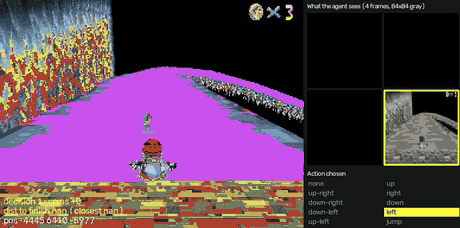
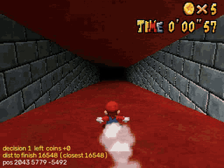
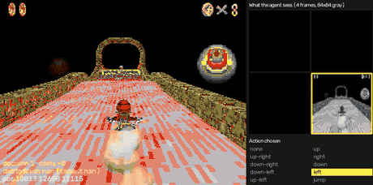
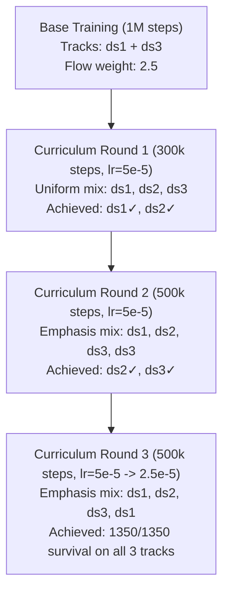

# Mario 64 DS - Reinforcement Learning (Slide Tracks & Vertical Clock Ascent)

This project trains visual reinforcement-learning agents in Super Mario 64 DS through DeSmuME. One BTR-style agent finishes the three slide courses; ascending Tick Tock Clock to its star remains an open task. RAM supplies rewards and episode-end checks; the deployed BTR policy receives pixels, not coordinates or the route.

**Current results and commands:** [slide agent](#slide-agent), [Tick Tock Clock BTR stages](#tick-tock-clock-current-btr-experiments), [setup and execution](#setup), [artifact provenance](results/MANIFEST.md). Older PPO, QR-DQN and world-model experiments are retained below as historical results; survival to a time limit is not proof of reaching a finish or collecting a star.

**Tracks (savestates located in `data/`):**

- `ds1` — Cool, Cool Mountain slide (penguin slide)
- `ds2` — Princess Peach's Secret Slide (The Princess's Secret Slide)
- `ds3` — Tall, Tall Mountain secret slide (Monkey slide)
- `ds8` — Course 14 full ascent (Tick Tock Clock / Slow setting)
- `ds9` — Course 14 star jump test platform (Tick Tock Clock)

---

<a id="slide-agent"></a>

## 🏁 Final agent: one value-based agent that finishes ds1, ds2 and ds3

One network, trained on all three slides at once with coin and finish rewards, no human demonstrations
and no distance, optical-flow, step or death terms. Each clip below is one greedy episode that
ends in the slide's finish region (`scripts/record_btr.py`; ds1 and ds2 finished on the first
attempt and ds3 on the second, [`results/btr_goal20_gifs.json`](results/btr_goal20_gifs.json)).
Left: the game, with the decision, the coins gained, the distance to the finish and the position.
Right: what the agent receives at that decision (its four 84x84 grayscale frames, oldest first, the
newest framed in yellow) and its ten actions with the chosen one lit. The GIFs are shown at 8
frames per second and 460 px wide to stay under GitHub's 10 MB inline limit; the mp4 files are the
full-size recordings.







Full-size mp4 files: [ds1](videos/btr/btr_ds1.mp4), [ds2](videos/btr/btr_ds2.mp4), [ds3](videos/btr/btr_ds3.mp4).
The checkpoints `models/btr_ref10/` and `models/btr_goal20/` (15 MB each) are not committed and are not listed in `models/ASSETS.json`.

**Result** (checkpoint `models/btr_goal20/step_1000005.pt`; greedy policy with the noisy layers
off, from each slide's start savestate, [`scripts/eval_btr.py`](scripts/eval_btr.py),
[`results/btr_goal20_eval_1M_x20.json`](results/btr_goal20_eval_1M_x20.json)), 20 episodes per slide:

| Slide | Episodes that finish | Median decisions (finishing episodes) | Median coins gained (finishing episodes) |
|---|---|---|---|
| ds1 (Cool, Cool Mountain) | 20 of 20 | 523 | 71 |
| ds2 (The Princess's Secret Slide) | 20 of 20 | 375.5 | 44 |
| ds3 (Tall, Tall Mountain slide) | 18 of 20 | 601 | 45 |

With 20 episodes per cell the uncertainty on a rate is large (18 of 20 is consistent with true
rates from roughly 70% to 97%, a 95% Wilson interval), and the same checkpoint gives different
outcomes from run to run because BTR samples 16 random IQN quantile levels at every decision even when the noisy layers are off. These greedy episodes are therefore not exact replays. (An earlier version of this README also blamed the emulator; it is deterministic, see "Deterministic evaluation" under Tick Tock Clock.)

**Perturbed starts** (same checkpoint and procedure, `--start-random 15`:
[`results/btr_goal20_eval_1M_perturbed15_x20.json`](results/btr_goal20_eval_1M_perturbed15_x20.json)). Before the agent
takes over, each episode plays a random number of random actions, from 0 to 15 (9.35 on average), one decision each;
a perturbation that already ends the episode is drawn again. The decisions below count from the moment the agent takes over.

| Slide | Episodes that finish | Median decisions (finishing episodes) | Median coins gained (finishing episodes) |
|---|---|---|---|
| ds1 perturbed | 20 of 20 | 516 | 66 |
| ds2 perturbed | 20 of 20 | 376 | 44 |
| ds3 perturbed | 17 of 20 | 594 | 44 |

The agent therefore does not depend on one exact trajectory from the savestate: after up to 15 random
decisions it still finishes ds1 and ds2 every time and ds3 in 17 of 20 episodes. This tests small
displacements of the start only, not other start positions on the slide.

**What the agent is.** An own implementation of the Beyond-the-Rainbow-style recipe
([`src/btr.py`](src/btr.py), not the authors' code): IMPALA CNN on 84x84 grayscale frames
(4-frame stack), IQN quantile head, dueling noisy layers, 3-step returns, Munchausen term,
prioritised replay, soft target updates, discount 0.99. It acts with the ten buttons of the
reference setup (`ref10`: none, up, up-right, right, down-right, down, down-left, left, up-left,
jump). Training: [`scripts/train_btr.py`](scripts/train_btr.py), 5 environments per slide, 15
in parallel.

**Reward and episode rules.** +1 for every coin (the RAM coin counter, `0x02098998`) and **+20
once when the episode ends in the finish region**. The +20 is the one deviation from the
reference's coin-only reward; everything else pays 0 (no death penalty, no step cost, no
distance, flow, star or demonstration term). Episodes end on the finish region (a position test
against the measured end area of each slide, `TRACK_GOALS` in `src/ram_state.py`), on a fall
below the course's `kill_y`, on the game's own respawn (a displacement above 2,000 units in one
decision, which the game does after a fall, with the coin counter reset), on `ds3` only on a long
free fall (more than 140 units per decision for 15 decisions), and at 1,500 decisions. The
black-screen death rule is off: the `ds3` route runs through a dark shaft where 60-90% of the pixels
are already dark ([`docs/HUMAN_RECORDING.md`](docs/HUMAN_RECORDING.md)), which that rule read as a death.

**How it was trained.** In two stages, 3.5M environment steps and about 5.5 hours of wall clock
in total (228.3 min + 102.8 min from
[`results/btr_ref10_train.csv`](results/btr_ref10_train.csv) and
[`results/btr_goal20_train.csv`](results/btr_goal20_train.csv); the machine also ran evaluations
and recordings during that time). Stage 1 (`btr_ref10`) used the coin reward only, 2.5M steps.
Stage 2 (`btr_goal20`, `--goal-reward 20`) started from the weights of the stage-1 checkpoint at
2.5M steps (the optimiser state and the replay buffer were not carried over) and trained 1M steps
more. Nothing was trained with human demonstrations in either stage.

**The finish test is a region, not the last tile.** In an episode of the 2.5M coin-only
checkpoint that ended in the `ds3` region, the game was kept running for 150 more decisions
([`results/ds3_after_finish_probe.json`](results/ds3_after_finish_probe.json)): the agent was 1,402.5
from the target when the test fired, 252.5 ten decisions later, on the flat floor of the end room
($Y = -13{,}646$), and gained no coin in any of those 150 decisions (the counter stayed at 44). So
the region fires about 10 decisions before the end room. For `ds1` and `ds2` the regions were
measured in the end rooms.

**Checkpoints compared** (same procedure, 20 episodes per cell; results in `results/btr_*_eval_*_x20.json`):

| Checkpoint | ds1 | ds2 | ds3 |
|---|---|---|---|
| coin-only, 2.5M steps (`btr_ref10`) | 19 of 20 | 20 of 20 | 17 of 20 |
| coin-only, 4.5M steps (`btr_ref10`) | 18 of 20 | 20 of 20 | 6 of 20 |
| coin + finish reward, 500k steps (`btr_goal20`) | 18 of 20 | 20 of 20 | 11 of 20 |
| coin + finish reward, 750k steps (`btr_goal20`) | 19 of 20 | 20 of 20 | 17 of 20 |
| coin + finish reward, 1M steps (`btr_goal20`, the clips above) | 20 of 20 | 20 of 20 | 18 of 20 |

**What this does and does not show.**

- The coin-only agent also finishes `ds3` at some checkpoints (17 of 20 at 2.5M), so the finish
  reward is not shown to be necessary. It is also not shown to be what made the difference: with 20
  episodes per cell, 18 of 20 against 17 of 20 is within noise.
- The coin-only agent's `ds3` rate is not stable across checkpoints (17 of 20 at 2.5M, 6 of 20 at
  4.5M). With the finish reward the three checkpoints evaluated went 11, 17 and 18 of 20, which
  could be early training or noise; no later checkpoints were evaluated. A hypothesis that fits this, and that was **not tested**: on the route these agents take
  there are no coins between the jump onto the last ramp and the end room (the probe above is one
  episode), so for a coin-only agent landing on the ramp and falling pay the same, and the policy at
  that jump drifts. The finish reward was added to break that tie.
- Several things changed between the earlier PPO work in this file and this agent at the same time:
  the algorithm (value-based BTR-style instead of PPO), the reward (coins instead of optical flow
  and distance) and the episode rules (black-screen death off, game respawn and long free fall
  counted as death, finish region), plus the action set. The only ablation run (below) was too short
  to separate any of them, so this README does not say which of them mattered most.
- Apart from the perturbed-start run above, all evaluations start from the training savestates, and no
  other start positions were tested. The checkpoint was picked after looking at the 500k, 750k and 1M
  evaluations (three looks, one chosen).
- The clips are single episodes that finished, not averages.
- The statements about `ds3` further down in this file (the open problem, the dead-end route, the
  PPO, QR-DQN, behaviour-cloning and search experiments) describe those experiments at the time
  and are kept as the record of what did not work; `ds3` is finished by the agent above.

**Ablation attempt: algorithm and action set, 1 hour each.** Four runs from scratch, one at a time, each
trained for 60 minutes of wall-clock time, then evaluated greedily for 20 episodes per slide. The
`control`, `ppo` and `legacy6` runs share the final agent's environment, episode rules and reward (+1 per coin, +20 at the finish); `orig` is an additional coin-only rerun
(`scripts/run_ablation.sh`; results in `results/abl_*_eval_x20.json`, training logs in `results/abl_*_train.csv`).
The runs differ in the number of steps they reach in 60 minutes, not in a fixed step budget.

| Run | Algorithm, actions | Steps in 60 min (last logged) | ds1 | ds2 | ds3 | Median closest distance to the finish, ds1 / ds3 |
|---|---|---|---|---|---|---|
| control | BTR-style, 10 actions | 420,000 | 0 of 20 | 20 of 20 | 0 of 20 | 4063 / 12007 |
| ppo | PPO, 10 actions | 920,010 | 0 of 20 | 20 of 20 | 0 of 20 | 8594 / 14855 |
| legacy6 | BTR-style, 6 actions | 500,010 | 0 of 20 | 20 of 20 | 0 of 20 | 9388 / 12137 |
| orig | BTR-style, 10 actions, coin reward only (original recipe) | 580,005 | 0 of 20 | 20 of 20 | 0 of 20 | 5678 / 10809 |

What this shows and does not show:

- None of the four finished `ds1` or `ds3` in one hour, and all four finished `ds2`. This ablation
  **does not separate the algorithm from the action set**: all four have the same finish counts.
- It therefore does not support "the reward mattered most" either. The first three runs hold reward and episode rules constant. The additional `orig` run removes the finish bonus, but one short run per setting with the same finish counts does not identify a reward effect.
- **The runs differ in speed, so they are compared at equal numbers of steps** (mean return per training
  episode on ds1 / ds2 / ds3; `orig` is a rerun of the first coin-only run `btr_ref10`: coin reward only,
  `--steps` 30M, same seed argument, same environment code):

  | Steps | `btr_ref10` (first run) | `orig` (rerun) | control (+20 at the finish) |
  |---|---|---|---|
  | 420,000 | 19.3 / 38.2 / 23.6 | 14.0 / 34.5 / 13.7 | 13.8 / 54.9 / 12.7 |
  | 580,005 | 54.6 / 41.7 / 34.4 | 15.0 / 39.1 / 23.6 | not reached in 60 minutes |

  At 420,000 steps the runs are close. By 580,005 steps the first run has jumped on ds1 (from 19.3 to
  54.6 return) and the rerun has not (15.0). Whether the rerun would jump with more steps was not
  tested; training runs are not bit-for-bit reproducible from a seed (the cause was not isolated; the emulator itself replays identical actions identically), and
  one run per setting says little about the setting. A difference in machine load between the runs
  cannot be ruled out.
- The control reached a smaller closest distance on `ds1` than PPO and `legacy6` (a median of 4063 against 8594 and
  9388). With one seed per run and 20 episodes this is a hint, not a result.
- PPO's hyper-parameters are common Atari defaults and were not tuned, which counts against it.

Reproduce:

```bash
python scripts/train_btr.py --run btr_ref10 --steps 30000000 --envs-per-track 5    # stage 1, coin reward only
python scripts/train_btr.py --run btr_goal20 --goal-reward 20 --steps 6000000 --envs-per-track 5 \
    --resume models/btr_ref10/step_2500005.pt                                     # stage 2
python scripts/eval_btr.py --model models/btr_goal20/step_1000005.pt --tracks ds1,ds2,ds3 --episodes 20
python scripts/record_btr.py --model models/btr_goal20/step_1000005.pt --track ds3 --attempts 10 --out videos/btr/btr_ds3.mp4
```

(Both runs were stopped by hand: stage 1 after about 5.5M steps, of which only the 2.5M-step checkpoint
feeds the final agent, and stage 2 after about 1.06M of its 6M steps, keeping the 1M-step checkpoint. The
`--steps` value also sets the schedule of the prioritised-replay exponent, so a shorter `--steps` is not the same run.)

---

## Tick Tock Clock: current BTR experiments

**Status on 2026-11-12:** no star success in the evaluated episodes; the best probed checkpoint (`btr_ttc_s9/step_750000`) reaches 344–348 of 370 payable waypoints (about 94% of the route by arc; earlier blocks stopped at 334–338), see [the blocks after the stall fix](#blocks-after-the-stall-fix-fall-truncation-and-checkpoint-selection-2026-11-10-to-2026-11-11). Stage 8 was a regression and is superseded (see [Stage 4 redone](#stage-4-was-redone-with-a-5000-decision-horizon) and [Plateau diagnosis and stall truncation](#plateau-diagnosis-and-stall-truncation)). The slide agent above and the TTC agent below are separate networks. The TTC policy is being trained to ascend from the full `ds8` start, rather than from progressively higher checkpoints.

**Target star:** the star the agent is trained to collect in Tick Tock Clock is **"Stomp on the Thwomp"** (stated by the user, who recorded the human route `config/routes/ttc_human_v1.json` that the waypoints come from). The environment does not check which star it is: success is any increase in the RAM star count (`Mario64DSEnv`, `star_collected`), so the route and the savestate are what select the objective.

### Reward, observations and episode rules

The active recipe is in [`scripts/train_btr.py`](scripts/train_btr.py), `ref_env_kwargs("ds8")`:

| Component | Current TTC setting |
|---|---|
| Newly passed route waypoint | +1, paid only for an increase of the route high-water mark |
| Star success | +100 once; ends the episode |
| Coins, vertical height, optical flow | 0 |
| Step cost, death and timeout penalties | 0 |
| Actions | `ref10`: no input, eight directions, jump (DS button B) |
| Observation | Four 84x84 grayscale frames; older frames at reset are zero-filled |
| Training starts | Full `ds8` savestate, 15 parallel emulator processes |
| Demonstration replay / reverse curriculum | Neither is used by this BTR runner |
| Horizon | 3,000 decisions in stages 1–3; 5,000 in stages 4–8 and `btr_ttc_fix` (the first attempt at stage 4 used 3,000 and was discarded) |
| Stall truncation | Optional `--stall-steps N` (default 0 = off): episode truncated after N decisions without a new waypoint; used only in `btr_ttc_fix` (N = 600) |

Training defaults are learning rate `1e-4`, AdamW weight decay `0.01` and epsilon `1.5e-4`, discount `0.99`, 3-step returns, batch size `128`, replay capacity argument `400000` (integer division across workers), 20,000 warm-up decisions and one gradient update per 15-environment vector step after warm-up. The soft target coefficient is `0.005`; IQN uses 8 quantiles for each training head and 16 for action selection. Munchausen parameters are `(0.9, 0.03, -1.0)`. The requested seed defaults to zero for NumPy and environment initialization; the runner does not explicitly seed PyTorch, so that argument is not a complete reproducibility guarantee. The `--device` training default is CUDA (the agent falls back to CPU if CUDA is unavailable).

The reward uses the human route [`config/routes/ttc_human_v1.json`](config/routes/ttc_human_v1.json): **371 waypoint positions over 53,245.8 units**. This is human-provided reward geometry, so the TTC experiment is not free of human guidance, even though it does not imitate human actions or prefill the replay with demonstrations. The route source is a 2,674-decision human ascent; its recording, checkpoints and replay data stay local.

Route progress projects Mario's RAM position onto a bounded portion of the polyline, within a 250-unit corridor, at most 600 units ahead and 300 behind the current best arc length. Only increasing the high-water mark can pay. One action can pass several waypoints; going backwards does not pay again. Counts below are `Route.passed(0, route_s)`: the initial waypoint at arc zero is excluded, so there are at most **370 newly payable waypoint crossings**, not 371 rewards from the route. The displayed denominator 371 names the number of recorded route positions. Route percentage uses arc length, not waypoint count or vertical height.

Episodes end on the star-success detector, a fall below the course floor, a detected game respawn, or the horizon. Black-screen death is disabled. Star success uses the environment's RAM/geometry rule: within 80 units of the target, or an increased star counter while within 500 units. The probe's `end="star"` is success under this detector, not an independently audited gameplay event.

### Eight completed stages

Each row evaluates its own final checkpoint on CPU for 10 episodes with `noisy=False`. IQN still samples 16 random quantile levels for action selection at every decision, so **greedy here does not mean an exactly deterministic replay**; the emulator is not the source (see "Deterministic evaluation" below). A single training lineage and ten probe episodes cannot establish statistical superiority or isolate the cause of an improvement.

| Stage / run | Last logged steps | Last logged minutes | Horizon | Waypoints / 371 | Route arc range | Deaths | Horizon endings | Star successes |
|---|---:|---:|---:|---:|---:|---:|---:|---:|
| 1 / `btr_ttc_wp` | 1,080,000 | 119.0 | 3,000 | 25–27 | 3,648.0–3,924.5 | 6/10 | 4/10 | 0/10 |
| 2 / `btr_ttc_wp2` | 980,010 | 117.6 | 3,000 | 58–63 | 8,559.6–9,240.3 | 1/10 | 9/10 | 0/10 |
| 3 / `btr_ttc_wp3` | 1,120,005 | 119.0 | 3,000 | 96–123 | 14,063.1–17,651.0 | 4/10 | 6/10 | 0/10 |
| 4 / `btr_ttc_wp4` | 1,000,005 | 186.6 | 5,000 | 108–134 | 15,544.2–19,260.5 | 7/10 | 3/10 | 0/10 |
| 5 / `btr_ttc_wp5` | 3,700,005 | 521.9 | 5,000 | 137–171 | 19,627.7–24,627.6 | 9/10 | 1/10 | 0/10 |
| 6 / `btr_ttc_wp6` | 2,020,005 | 203.5 | 5,000 | 170–185 | 24,556.6–26,649.0 | 3/10 | 7/10 | 0/10 |
| 7 / `btr_ttc_wp7` | 4,000,005 | 460.2 | 5,000 | 204–204 | 29,358.6–29,358.6 | 0/10 | 10/10 | 0/10 |
| 8 / `btr_ttc_wp8` | 1,500,000 | 156.8 | 5,000 | 18–24 | 2,704.7–3,545.1 | 5/10 | 5/10 | 0/10 |

| Stage | Mean route progress | Maximum route progress |
|---|---:|---:|
| 1 | 7.1% | 7.4% |
| 2 | 16.8% | 17.4% |
| 3 | 28.8% | 33.2% |
| 4 | 30.6% | 36.2% |
| 5 | 38.7% | 46.3% |
| 6 | 48.5% | 50.0% |
| 7 | 55.1% | 55.1% |
| 8 | 5.2% | 6.7% |

Percentages above use each probe episode's maximum **arc length**, divided by the full route length, then averaged or maximized across ten episodes. They are not the fraction of waypoint positions, final position, a recent training mean, or a completion rate. This distinction is necessary when comparing the stage results with the live reports.

Sources: each run's [`results/btr_ttc_wp*_train.csv`](results/) and [`results/ttc_probe_btr_ttc_wp*.json`](results/), consolidated with LF-normalized text-source hashes and raw binary checkpoint hashes in [`results/ttc_btr_stages.json`](results/ttc_btr_stages.json). Stage 1 uses the name `btr_ttc_wp` without a trailing 1. Step and minute columns are the **last periodic CSV sample**, not the exact final step count or complete process duration; recording every 20,000 aggregate decisions leaves an unlogged tail. The 15 workers' decisions are summed, not counted separately as emulator frames. Wall-clock time and steps differ between stages, so the stages are not equal-budget ablations.

Stage 1 was trained from scratch. Stages 2–8 load the preceding stage's `final.pt`. Loading transfers policy weights and copies them into the target network; **optimizer state, replay, update counter and the replay-importance schedule restart**. The checkpoint contains the network weights and action count, not an uninterrupted training session. The maximum `--steps 30000000` also defines the importance-sampling schedule; replacing it with a smaller step target changes that schedule even when training stops on wall time.

### Stage 4 was redone with a 5,000-decision horizon

Stage 4 was run twice. The first run (`btr_ttc_wp4`, from `models/btr_ttc_wp3/final.pt`, 15 environments, **3,000-decision horizon**, 143.6-minute budget) peaked at 20,259 route arc length in the noisy training window, but its greedy ten-episode probe regressed to **50–64 waypoints (13.7% of arc length)**, below stage 3's 96–123, with episodes ending at the horizon. A forensic comparison of the commands found no code or hyperparameter change between stages 3 and 4 other than the time budget (`--max-minutes`); the probe discrepancy was attributed to the 3,000-decision limit being too short once the policy hesitated, but no matched experiment isolated that. The run was discarded: its commit was removed, and its checkpoint directory was deleted (the untracked `.pt` files could not be recovered).

Stage 4 was then rerun from the unchanged stage-3 final weights with `--max-steps 5000` (and the probe also with 5,000), giving the stage-4 row above: **108–134 waypoints**. All later stages use 5,000. Stages 1–3 used 3,000, so the horizon is not constant across the table. The two stage-4 runs also differ in wall time (143.6 min vs 186.6 min) and random emulator trajectories, so the improvement cannot be attributed to the horizon alone. Only the redone stage 4 is in `results/btr_ttc_wp4_*`.

### Stage 6: final evaluation and training curve

Stage 6 reached **170–185 crossings** (median 183.5), with a route high-water mark of **24,556.6–26,649.0 units**, or 46.1%–50.0% of the route length. Height gain above the initial position ranged from +4,351.2 to +6,202.0. There were **3 deaths, 7 horizon endings and 0 star successes**. Stage 5 reached 137–171 crossings with 9 deaths; this comparison describes the sampled outcomes, not a significance test.

During stage 6, the peak logged recent mean return was 174.13, and the peak logged mean route progress was 25,143. The final periodic sample fell to 128.07 return and 18,484 route units. Learning was therefore **not monotonically improving**; intermediate training progress is not evidence that the final policy retained the same behavior. The runner started at 07:34:55 and training finished at 11:00:05 America/Sao_Paulo; the probe finished at 11:16:30. See [`results/ttc_probe_btr_ttc_wp6.json`](results/ttc_probe_btr_ttc_wp6.json) for every episode.

The training CSV's `ds8_coins` field is a historical name for **mean episode return over up to the last 30 completed episodes**, not coins collected. `ds8_route_s` is the mean route high-water mark over the same recent completed episodes, and `ds8_len` is mean episode length. These training statistics use exploration and are not a greedy success rate. Coins can still be picked up during TTC gameplay but contribute zero reward.

**Observed obstacle:** the user identified a pillar that Mario needs to climb in the stage-5 recording. Eight of the ten stage-5 probe episodes stopped at `route_s=19627.7` (137 crossings), and two reached approximately 24.5k. The probe does not record action/position traces or obstacle labels, so mapping that repeated plateau to the pillar, or concluding that unfamiliarity causes the stall, remains a hypothesis. More training is not a guarantee that this maneuver will be learned. The evaluation shows how far the checkpoint gets, not which obstacle caused each death.

### Stage 7: final evaluation and conditional continuation

Training finished at 18:59:31 America/Sao_Paulo on 2026-11-09, and the ten-episode probe finished at 19:21:40. The final checkpoint reached **204–204 waypoint crossings**, with mean route progress **55.1%** and maximum **55.1%**. There were **0/10 deaths, 10/10 horizon endings and 0/10 star successes**. Raw evidence: [`results/ttc_probe_btr_ttc_wp7.json`](results/ttc_probe_btr_ttc_wp7.json).

The peak logged recent training mean was 55.4%; it is not an individual-episode maximum. The final periodic sample recorded 202.13 return and 29,084 route units. Reaching the horizon after a fall or a long stationary period is not proof that more episode time would produce further ascent. No matched 5,000-versus-10,000-decision evaluation was performed.

The final-checkpoint video is local at `videos/ttc_wp7_19h_small.mp4`: one 5,000-decision attempt, 335.4 seconds including the hold. Its metadata and checkpoint hash are in [`results/ttc_wp7_19h_video.json`](results/ttc_wp7_19h_video.json). It is separate from the ten-episode probe and from the earlier 3M-step clip.

The authorized absence-of-proven-success condition triggered a continuation: stage 8 (`btr_ttc_wp8`) started at 19:21:45 from the stage-seven final weights, with unchanged rewards and a 5,000-decision horizon, targeting 22:00. Its final results are recorded in the stage-eight section below. The recorded decision is [`results/ttc_stage7_extension_decision.json`](results/ttc_stage7_extension_decision.json); training-star count remains unknown because the running trainer did not record it. Full-route progress was accepted as an alternative stopping proxy, not as a collected-star claim.

### Stage 8: final authorized continuation

The stage started at 19:21:45 and training ended at 21:59:34 America/Sao_Paulo on 2026-11-09. The ten-episode final probe completed at 22:12:38. Its route-progress mean was **5.2%**, with a maximum of **6.7%**, 18–24 crossings, **5/10 deaths, 5/10 horizon endings and 0/10 star successes**. Evidence: [`results/ttc_probe_btr_ttc_wp8.json`](results/ttc_probe_btr_ttc_wp8.json).

The mean is lower than stage 7's 55.1% on the sampled final-checkpoint probes. Stage 8's peak logged recent training mean reached 55.7%, while the last periodic sample was 21.2% (77.80 episode return). Training-window means are not individual episode maxima or greedy validation. These observations do not isolate a cause: the stage kept the same recipe and horizon, but started a fresh optimizer/replay from transferred weights. No matched 5,000-versus-10,000-decision experiment was run.

The stage-seven checkpoint remains separate at `models/btr_ttc_wp7/final.pt`; the stage-eight run did not overwrite it. No further training beyond 22:00 was authorized or launched. Training-star counts remain unavailable, so zero validation stars must not be described as proof of zero training stars. The 19:00 video documents stage 7, not this stage-eight checkpoint.

### Plateau diagnosis and stall truncation

Stage 7 stopped at exactly **204 waypoints (arc 29,358.6) in all ten probe episodes**, and stage 8, started from it with the same recipe, collapsed (18–24 waypoints). Analysis of the stage-7 video trace (`results/ttc_wp7_now_3M_video.json`), training CSVs and probes found:

- At the plateau Mario climbs a pillar to height about +2,300, passes waypoint 204, does not find the next movement, drifts and falls to the starting floor.
- After the fall, **4,054 of 4,999 decisions (81%) were no-input**: waypoint reward pays only for raising the route high-water mark, so redoing the climb pays zero and idling is as good as anything else. There is no step, fall or stall penalty.
- Consequently most training episodes (4,800–5,000 decisions) and most replay contents were stationary, zero-reward frames; the difficult region received about 1,000 decisions per episode.
- Stage 8 training was stable for about 650,000 steps, then episode return fell from about 206 to 50–78 and the loss rose from about 0.003 to 0.15–0.27. The replay-content explanation is a **hypothesis consistent with these data, not proven**; optimizer and replay were also reset at each stage.

**Fix tested:** `--stall-steps 600` (`Mario64DSEnv(stall_steps=...)`) truncates the episode after 600 decisions without a new waypoint. The longest gap between progress increments in the successful climb was 89 decisions. Rewards and algorithm are unchanged. Run `btr_ttc_fix` restarted from `models/btr_ttc_wp7/final.pt` (not stage 8), 120 minutes, 5,000-decision horizon, 1.08M logged steps. Training did not collapse (return stayed 200–211, episodes about 1,600 decisions instead of about 5,000). The ten-episode probe, run **without** the stall cutoff (`results/ttc_probe_btr_ttc_fix.json`), reached **210–214 waypoints** (arc 30,183.9–30,588.4; maximum height about 2,600), versus 204 for stage 7; 8 episodes reached the horizon, 2 died at decision 1,124, **0 stars**. The gain is 6–10 waypoints, so the plateau persists: the fix removed the idling and the stage-8 instability, but the agent still does not learn the maneuver after the pillar. One run per setting and a non-deterministic emulator mean this is weak evidence. Further exploration (for example starting from intermediate route states) remains untested.

### Blocks after the stall fix: fall truncation and checkpoint selection (2026-11-10 to 2026-11-11)

All blocks below load policy weights from a single parent (optimizer, replay and update counter restart), train on the full `ds8` start only (no intermediate start states), use the same reward (+1 per waypoint, +100 star, no coins), horizon 5,000 and `--stall-steps 600`. Step and minute columns are the last periodic CSV sample, not exact final values. Every block was capped at 120 minutes. Probes use 10 episodes for blocks `fix`-`fall3` and 5 episodes per checkpoint for `s1` onward; waypoint counts are `Route.passed(0, route_s)` out of 370.

**Fall truncation** (`--fall-drop 1500`, added at `fall`): the episode ends when Mario drops more than 1,500 units below the highest point reached in that episode (the human route's own largest drop is about 516). Before it, the greedy policy fell and stayed idle until the horizon, because the ratcheted route progress pays nothing for redoing the climb. It is the only version of this rule that was implemented. It does not change where episodes start: the environment resets to the same full-start savestate.

**Checkpoint selection** (from `s1`, `scratch/ttc_driver2.py`, a local driver that is not part of the training recipe): the trainer saves a checkpoint every 250k steps plus `final.pt`; after each block each one is probed for 5 episodes and the best (highest median waypoints, ties by the worst episode) is carried to the next block, only if it beats its starting checkpoint's own score. The learning rate was also lowered from `1e-4` to `5e-5` at `s1`; this was a guess to reduce instability, and its effect is **not isolated**: no control block with `1e-4` and the same selection was run. The five-episode selection probe can favour a lucky checkpoint, so these medians are not a validation.

| Block / run | Parent weights | Last logged steps | Minutes | Waypoints / 370 (probe) | Deaths | Stars |
|---|---|---:|---:|---|---|---|
| `btr_ttc_fix` | stage 7 final | 1,080,000 | 119.6 | 210–214 (10 ep.) | 2/10 | 0 |
| `btr_ttc_fix2` | `fix` final | 1,040,010 | 119.9 | 169–215 (10 ep.) | 4/10 | 0 |
| `btr_ttc_fall` | `fix2` final | 980,010 | 119.1 | 227–228 (10 ep.) | 2/10 | 0 |
| `btr_ttc_fall2` | `fall` final | 1,020,000 | 118.0 | 261–298 (10 ep.) | 1/10 | 0 |
| `btr_ttc_fall3` | `fall2` final | 1,080,000 | 118.0 | 168, 204 (x9) (10 ep.) | 1/10 | 0 |
| `btr_ttc_s1` | `fall2` final (`fall3` discarded) | 1,060,005 | 118.9 | best checkpoint: 297-302 | 1/5 | 0 |
| `btr_ttc_s2` | `s1` step 1,000,005 | 1,140,000 | 118.1 | best checkpoint (250k): 330–337 | 0/5 | 0 |
| `btr_ttc_s3` | `s2` step 250,005 | 1,140,000 | 119.6 | final: 334–336 | 0/5 | 0 |
| `btr_ttc_s5` | `s3` final | 1,060,005 | 119.1 | best checkpoint (750k): 336–338; final 299–336 | 1/5 | 0 |
| `btr_ttc_s6` | `s5` step 750,000 | ~300,000 (aborted) | ~33 | no probe | – | – |
| `btr_ttc_s7` (`--fall-drop 800`) | `s5` step 750,000 | 1,100,010 | 118.5 | all checkpoints 158–171 (collapsed) | 10/25 over five checkpoints | 0 |
| `btr_ttc_s8` (`--fall-drop 1500` again) | `s5` step 750,000 | 960,000 | 118.8 | 250k: 301–341 (median 339); 750k: 336–339; final: 333–339; 500k: 188–204 | 2/5 (250k) | 0 |
| `btr_ttc_s9` | `s8` step 250,005 | 1,140,000 | 119.4 | 750k: 344, 344, 348, 348, 348; 250k: 308–336; 500k: 297–337; 1M: 227–296; final: 293–336 | 0/5 (750k) | 0 |
| `btr_ttc_s10` | `s9` step 750,000 | 1,140,000 | 119.7 | 1M: 340 (5/5); 500k: 336–340; 750k: 335–340; 250k: 91–102; final: 161–163 | 1/5 (750k) | 0 |
| `btr_ttc_s11` | `s9` step 750,000 | 1,140,000 | 119.0 | 500k: 299, 336, 337, 339, 350; final: 336–337; 250k: 296–303; 750k: 171 (5/5); 1M: 169–174 | 1/5 (500k) | 0 |
| `btr_ttc_s12` | `s9` step 750,000 | 1,140,000 | 119.2 | final: 297–338 (median 302); 750k: 297–308; 1M: 299–332; 500k: 174–265; 250k: 176 (5/5) | 0/5 | 0 |
| `btr_ttc_s13` | `s9` step 750,000 | 1,060,005 | 119.2 | 1M: 300–301; 750k: 297–301; 500k: 297–300; 250k: 261–302; final: 176–186 | 1/5 (1M) | 0 |
| `btr_ttc_s14` | `s9` step 750,000 | 1,000,005 | 118.9 | final: 340 (5/5); 1M: 339 (5/5); 750k: 297–336; 500k: 296–339; 250k: 272–296 | 2/5 (final) | 0 |
| `btr_ttc_s15` (4 h, `--max-minutes 240`) | `s9` step 750,000 | 1,760,010 | 238.4 | 250k: 294–300; 500k: 297–301; 750k: 296–299; 1M: 298 (5/5); 1.25M: 170, 170, 170, 300, 301; 1.5M: 297 (5/5); 1.75M: 297 (5/5); final: 152, 154, 163, 301, 338 | 0–4 per checkpoint | 0 |
| `btr_ttc_s16` (end-of-route starts, see below) | `s9` step 750,000 | 380,010 | 116.9 | 250k: 158–168 (median 164); final: 158–180 (median 161) | 1/5 (250k), 0/5 (final) | 0 |

Per-checkpoint probes of `fall3`, `s1`, `s2` and `s3` are in `results/ttc_probe_btr_ttc_<run>_*.json`. Within a block checkpoints vary widely: in `fall3` the 500k checkpoint reached 59–64 waypoints, the 750k one 267–297 and the final one 204; in `s3` the 750k checkpoint reached 98–170 while the final reached 334–336. The cause of this instability is **not identified**, so the final checkpoint of a block cannot be assumed to be its best.

Naming: the runs were named `btr_ttc_fall{n}` until `fall3` regressed, and `btr_ttc_s{n}` afterwards, because a second driver restarted its counter. The weight lineage is `stage 7 -> fix -> fix2 -> fall -> fall2 -> s1 -> s2 -> s3`; `models/btr_ttc_fall3` and the partial `btr_ttc_fall4` (killed right after it started) are not on it. A later block `btr_ttc_s4` was interrupted after about 47 minutes when the training process disappeared (cause unknown); it is also not on the lineage, and training continued from `s3/final` as `btr_ttc_s5`. `btr_ttc_s6` was stopped by hand at about 33 minutes so that a block could be restarted with a tighter fall cutoff; it is not on the lineage (`models/btr_ttc_s6_aborted`). That block, `btr_ttc_s7`, used `--fall-drop 800` (from `s5` step 750,000): every one of its checkpoints probed at 158–171 waypoints, far below the 336 it started from, and its training episodes fell to about 630 decisions (arc about 22,700, against about 43,000 in `s5`). The cause was not isolated (the single change was the cutoff, but this is one run); the cutoff went back to 1,500 and `btr_ttc_s8` restarts from the same `s5` step 750,000 checkpoint. After `s9` the weights carried forward stayed `btr_ttc_s9/step_750000` through `s10` to `s14`: no later checkpoint beat its five-episode score (median 348, minimum 344). `s10` to `s14` all started from it; `s14` was the most stable block (final and 1M checkpoints identical across five episodes at 340 and 339) but still below 344–348. A single 4 h block, `btr_ttc_s15` (`--max-minutes 240`, same recipe, from the same checkpoint), was then started to test whether restarting the optimizer and replay every 2 h matters. Result: no checkpoint of the 4 h block exceeded 301 waypoints except one episode at 338 (final); the eight saved checkpoints sit at 297–301 or collapse to ~170, so a single continuous 4 h run did not do better than the 2 h blocks (one run, one start point). Within these blocks the checkpoints again differ widely (for example 91–102 at 250k and 340 at 1M in `s10`; 171 at 750k and 337 at 500k in `s11`), and the cause is still not identified. Models, videos and these local drivers are not committed.

**Status:** no star has been observed in any probe episode. Best carried checkpoint so far: `btr_ttc_s9/step_750000` (344–348 of 370 waypoints in five probe episodes; the highest single episode is 350, in `s11`). The best five-episode probes reach 334–338 of 370 waypoints (about 90% of the route length by arc) and appear to stop there. Over `s2`, `s3` and `s5` no probe episode exceeded 338; in `s8` three episodes did (339, 339 and 341 at the 250k checkpoint, 339 at 750k and at final), so the maximum moved by up to 3 waypoints. In `s9` the 750k checkpoint reached 344, 344, 348, 348 and 348 (the first time every episode of a checkpoint passed 340), while the other four checkpoints of the same block stayed at 227–337. The `s8` medians (333–339) did not move beyond the earlier plateau, and the 250k checkpoint with the highest median also had two episodes at 301.

### Where the plateau is (trace and videos, 2026-11-11)

`scripts/trace_ttc.py` logged position per decision for three episodes of `btr_ttc_s3/final` (`results/ttc_trace_btr_ttc_s3_final.json`, 334–336 waypoints): the best route progress came at decisions 1,580, 1,610 and 1,656 (waypoints 330, 338 and 336), at heights 5,573–5,857 and 171–206 units from the nearest waypoint (the corridor is 250). Afterwards Mario left the route and fell to heights -2,430, -4,710 (the start floor) and 2,564, then stood still until the 800-decision idle cutoff of the trace. The human route stays near height 5,910 over waypoints 338–345. The agent reaches this point about 1,000 decisions faster than the 2,674-decision human run.

Watching the recordings of `s5/step_750000`, the user reports that Mario reaches the height of the clock hand and falls, and in one episode reaches the hand and falls because he keeps moving on it. The working hypothesis is therefore that the stall is the section where Mario has to stand on the moving hand. The object was not identified from RAM, and a few recorded episodes do not establish it. The recordings and the probe run without the training cutoffs, so the long idling after a fall seen there does not happen in training (stall 600 and fall cutoff 1,500 end the episode).

### Re-evaluation of `btr_ttc_s9/step_750000` (2026-11-12)

After `s10`, `s11` and `s12` failed to beat it, the carried checkpoint was probed again with fresh episodes (horizon 5,000, no training cutoffs; `results/ttc_reeval_s9_750k_*.json`): ten stochastic episodes gave 182, 336, 344, 344, 344, 348, 348, 348, 348, 348 waypoints (median 346; one episode ended by death, nine at the horizon), and one `--deterministic` episode gave 348. So the 344–348 of the selection probe holds up for nine of ten episodes; one episode stayed at 182, which the original five did not show. The five 348-waypoint episodes share the same maximum height (6,154.5), and the 344 ones share 6,113.0, so the agent is repeatedly stopping at the same two places, not at random ones. Their location and cause were not examined; the earlier hypothesis (the moving clock-hand section) is not tested by this data.

**User observation on the deterministic video of `btr_ttc_s9/step_750000` (2026-11-12):** the agent manages to stay on the clock hand and falls when it leaves it for the next platform. This replaces the earlier hypothesis that it cannot stay on the hand (from the `s5` recordings); the stall is the transfer from the hand to the next platform. This comes from watching one deterministic episode, not from RAM data or a trace of that checkpoint.

### Trace of `btr_ttc_s9/step_750000` and a block with end-of-route start states (2026-11-12)

**Trace** (`results/ttc_trace_btr_ttc_s9_750000_det.json`, one `--deterministic` episode, 2,083 decisions until the 400-decision idle cutoff): the best route progress is 50,226.5 arc length, at decision 1,683, position (1009.5, 5910.0, 947.9). Mario rides the hand at height 5,910 for the preceding decisions (decision 1,676: x 1150.5, z 772.3, same height) and moves along it to x about 811 (decision 1,692-1,696), then jumps (height 6,125), does not land on the next platform and falls to about 4,800, where he stands still. The human run in the same area goes from height 5,910 (decision 2,580, position 979.7, 5910.0, 737.8) to a platform at 6,081.7 (decision 2,590, 1181.1, 956.6). In this one episode the agent was therefore still on the hand but left it at a different place and in a different direction than the human did; this is one trace, not a statistic.

**Experiment: start states at the end of the route.** The user asked to try intermediate starts near the hand. `scripts/dense_human_states.py` replays the human run and saves a savestate every 10 decisions (the first version of that script replayed only the decision actions, not the recorded per-frame inputs, and produced wrong positions; it now uses `decision_inputs` and aborts when the replay diverges from the recording). `scripts/select_route_states.py` keeps the states whose position is inside the route corridor: 16 states, decisions 2,510 to 2,660, route arc length 48,574 to 53,246 (height 5,910 on the hand up to the final platform). `train_btr.py --start-states data/curriculum/ttc_end_valid --full-start-prob 0.5` starts half of the training episodes from the normal `ds8` start and half from one of these states (uniform); an episode that starts from a state is only paid for the route beyond that state, and all other settings of the recipe stay the same. The savestates are local (`data/curriculum/` is not tracked); the commands to regenerate them are the two scripts above with the human attempt `20261103-181832/attempt-000005`. Evaluation (probes, traces, videos) never uses these starts.

Result of the block `btr_ttc_s16` (from `s9` step 750,000, lr 5e-5, 120 minutes, 5,000-decision horizon, stall 600, fall cutoff 1,500): the training CSV shows the loss rising from 0.11 to 1.1-2.6 and the mean route arc length of the training episodes (which now includes the end starts) falling from 49,487 to 33,000-42,000; the block was slower (about 380,000 steps in 117 minutes, against about 1.0-1.2 million in the other 2-hour blocks), most likely because the episodes are shorter and every reset reloads a savestate (not measured). Probes from the normal start: `step_250005` reached 161, 161, 164, 165 and 168 waypoints (one death) and `final` 158, 161, 161, 165 and 180 waypoints, far below the 344-348 of the checkpoint it started from. No star. Per the user's instruction the next blocks were not run because the agent got worse. This is a single block with fewer steps than the others, so it shows that this variant (50% end starts, from `s9`) did not help in one block, not that end starts cannot help in general; no cause for the regression to 161-180 was identified.

### Does the action set limit the hand-to-platform jump? (2026-11-13, evaluation only)

The agent plays with `ref10` (None, eight directions, jump = the B button alone), taken from the coin-agent video this project follows. The human run was recorded with `compound12`, which has held combinations; at the transfer the human pressed up+left+B (decision 2,580, two decisions) and then held up+B for 12 decisions (2,582-2,593), a flight that rises from height 5,910 to 6,178 and lands on the next platform at 5,900 (position 1275, 1096). The comment in `src/env.py` records that up+B travels 148.8 units against 62.2 for "up, then B" (40 frames, measured on `ds8`).

Test (`scripts/search_ttc_jump.py`, results in `results/ttc_jump_search_*.json`): from the human savestate on the hand just before the transfer (decision 2,580, and also 2,570), 600 random action sequences of 28 decisions (each random action held 1-8 decisions), the same budget and generator for both action sets. A trial counts as success when the route arc length reached is at least 51,000 (the human is at 50,683 at decision 2,590 and 51,370 at 2,600) and Mario is still above height 5,800 at the end.

| Start | Action set | Success (>= 51,000) | >= 51,300 | >= 51,500 |
|---|---|---:|---:|---:|
| decision 2,580 | `ref10` | 2 / 600 | 0 | 0 |
| decision 2,580 | `compound12` | 149 / 600 | 89 | 55 |
| decision 2,570 | `ref10` | 1 / 600 | 0 | 0 |
| decision 2,570 | `compound12` | 37 / 600 | 13 | 2 |

Random sequences with the combined buttons find the transfer about 75 times (decision 2,580) and 37 times (decision 2,570) more often. The two `ref10` successes at 2,580 only just pass the threshold (51,206 and 51,209) and no `ref10` trial passes 51,300. This does **not** prove the transfer is impossible with `ref10`, and a random search is not a trained policy; the success criterion is mine, evaluated after 28 decisions. It is evidence that the missing combined jump is a likely cause of the stall at the hand, independent of the amount of training. It has not been tested by training.

### Deterministic evaluation (2026-11-11)

Earlier versions of this README said the emulator is not deterministic. That was an assumption and it is wrong for the part that was tested: replaying 500 fixed random actions from the `ds8` savestate three times in the same process gave identical positions at every decision (`scratch/det_test.py`, local; only that 500-decision case was checked). The variation between greedy episodes comes from the policy: `BTRAgent.act` draws 16 random IQN quantile levels at every decision, even with `noisy=False`.

`BTRAgent.act(..., fixed_taus=True)` replaces them by the midpoints (i+0.5)/16, and `probe_ttc.py`, `record_btr.py` and `trace_ttc.py` take `--deterministic` for it. Training is unchanged. Check made: two separate processes, each running `btr_ttc_s5/step_750000` for 2 episodes of 2,200 decisions with `--deterministic`, produced four identical episodes (336 waypoints, max height 5,814.6, final height 3,810.5). The deterministic video `videos/ttc_s5_det.mp4` (local) is that episode. Under the default stochastic evaluation the same checkpoint gave 336, 336, 336, 336, 338 in the five-episode probe. Deterministic evaluation is one trajectory, not a distribution: a deterministic score can be better or worse than the stochastic median, and it does not replace several stochastic episodes when judging a checkpoint.


### Reproduce training, evaluation and video

Use the repository `.venv` interpreter on this machine. The recorded runtime and hashes in the consolidated JSON describe the environment used when stage 6 was evaluated; `requirements.txt` is a different dependency snapshot and must not be described as the exact environment of these runs. In particular, the observed runtime is Python 3.11.9, PyTorch 2.5.1+cu121, CUDA 12.1, NumPy 2.4.6, OpenCV 5.0.0.93, Gymnasium 1.2.3, Stable-Baselines3 2.8.0 and py-desmume 0.0.9, with an RTX 4070 Laptop GPU for training. These are provenance observations, not changes to the training recipe. Earlier stages did not save their own full runtime manifests.

```powershell
# From scratch: use a NEW run name to avoid overwriting existing checkpoints.
.venv\Scripts\python.exe scripts/train_btr.py --run ttc_reproduction --tracks ds8 --envs-per-track 15 --steps 30000000 --max-steps 5000 --max-minutes 120

# Stall-truncation continuation from the best stage (stage 7), as in btr_ttc_fix.
.venv\Scripts\python.exe scripts/train_btr.py --run btr_ttc_fix --tracks ds8 --envs-per-track 15 --steps 30000000 --max-steps 5000 --stall-steps 600 --max-minutes 120 --resume models/btr_ttc_wp7/final.pt

# Continue from stage 6 using the same loading mechanism; optimizer and replay restart.
.venv\Scripts\python.exe scripts/train_btr.py --run ttc_continuation --tracks ds8 --envs-per-track 15 --steps 30000000 --max-steps 5000 --max-minutes 120 --resume models/btr_ttc_wp6/final.pt

# Match the training horizon; the probe runs its policy on CPU.
.venv\Scripts\python.exe scripts/probe_ttc.py --model models/btr_ttc_wp6/final.pt --episodes 10 --max-steps 5000 --out results/ttc_probe_reproduction.json

# One complete attempt, including the agent's four input frames and chosen action.
.venv\Scripts\python.exe scripts/record_btr.py --model models/btr_ttc_wp6/final.pt --track ds8 --max-steps 5000 --attempts 1 --out videos/ttc_wp6.mp4

# Same, deterministic (fixed quantile levels): the episode repeats exactly.
.venv\Scripts\python.exe scripts/record_btr.py --model models/btr_ttc_wp6/final.pt --track ds8 --max-steps 5000 --attempts 1 --deterministic --out videos/ttc_wp6_det.mp4

# Per-decision position trace (see results/ttc_trace_btr_ttc_s3_final.json).
.venv\Scripts\python.exe scripts/trace_ttc.py --model models/btr_ttc_s3/final.pt --episodes 3 --out results/ttc_trace_btr_ttc_s3_final.json

# Optional compact playback copy (requires FFmpeg).
ffmpeg -i videos/ttc_wp6.mp4 -c:v libx264 -preset fast -crf 25 -pix_fmt yuv420p -movflags +faststart -an videos/ttc_wp6_small.mp4
```

The already recorded stage-5 clip is local at `videos/ttc_wp5_small.mp4`: one 5,000-decision attempt, 335.4 seconds including the final hold, about 20.5 MB. It survived to the horizon; it is not the ten-episode probe or a video of stage 6. Models, human recordings and these TTC videos are not uploaded by the result commits, and a clean clone cannot play a local-only video or load these checkpoints. Summary hashes identify local model bytes but do not distribute them.

### Continuation through 19:00 on 2026-11-09

After the stage-6 evaluation and this documentation update, stage 7 (`btr_ttc_wp7`) resumed from `models/btr_ttc_wp6/final.pt` with the same recipe, one continuous invocation and a wall-time budget ending near 19:00 America/Sao_Paulo. Reports are requested for 13:00, 15:00, 17:00 and 19:00. Reports describe the current training window; they are not fresh ten-episode evaluations unless an evaluation file exists. A final ten-episode probe runs after training stops, so its results may become available after 19:00. Stage 7 is now complete and included in the completed-stage tables above.

The user subsequently authorized a conditional continuation through **22:00**: after the 19:00 checkpoint video and ten-episode validation, start stage 8 from stage 7 only if no star success or full-route progress is recorded. Full-route progress is an alternative stopping criterion, not proof of collecting the star; route projection and star success use different checks. The stage-7 trainer did not record a per-episode star log, so absence of a recorded training success cannot certify zero training stars. The user explicitly accepted using absence of proven success, with the route proxy, for this decision. The local decision record is `results/ttc_stage7_extension_decision.json`, and the single-attempt checkpoint video is `videos/ttc_wp7_19h_small.mp4`. The extension ran, with a 21:00 progress report and the closing report after the final probe following 22:00. Recording and validation take time after 19:00; stage 8 starts only after the condition can be checked. Its optimizer and replay restart in the same way as the previous stage transfers.

Scripts and status files for the local time-budget runner are operational artifacts under ignored `scratch/` and `logs/`; the public Python commands above describe how to reproduce the training mechanism.

Earlier unsuccessful TTC attempts used length-scaled route rewards, initially with coins and then without them. Their evidence remains in `results/btr_ttc_route*_train.csv`, `results/btr_ttc_nocoin_train.csv` and the corresponding probe JSONs. Those rewards differ from the waypoint recipe, so their returns should not be compared directly. The QR-DQN route/curriculum/demonstration experiment is preserved in the historical section near the execution guide.

---

## 🎥 Historical dashboard of the PPO agent (optical-flow reward)

This section and the next one describe the earlier PPO agent `curriculum_flow25_r3_best`, not the
final agent above. One deterministic 1350-decision episode per track, recorded by
`scripts/record_dashboard.py` under the [`rust/`](rust/README.md) supervisor
(`--supervisor rust --parallel 3`). Every figure below is what the clip itself
displayed, and `tools/check_readme_numbers.py` re-derives each cell from
`videos/dashboard/dashboard_*.json` — including the $\times 2.5$ column, which is
recomputed from the logged weight-free flow sum rather than copied.

| Track | Steps survived | R at flow $\times 1.0$ (single recorded episode) | R re-priced at $\times 2.5$ | Fast-fall clamps (not falls) | Near-stationary decisions | Clip |
|---|---|---|---|---|---|---|
| `ds1` (Cool, Cool Mountain) | 1350 / 1350 | +131.77 | +369.94 | 2 | 695 | [dashboard_ds1.mp4](videos/dashboard/dashboard_ds1.mp4) — 90.0 s, 60 fps, policy on cpu |
| `ds2` (Peach Slide) | 1350 / 1350 | +329.92 | +865.29 | 1 | 226 | [dashboard_ds2.mp4](videos/dashboard/dashboard_ds2.mp4) — 90.0 s, 60 fps, policy on cpu |
| `ds3` (Monkey Slide) | 1350 / 1350 | +185.40 | +504.01 | 3 | 298 | [dashboard_ds3.mp4](videos/dashboard/dashboard_ds3.mp4) — 90.0 s, 60 fps, policy on cpu |

**Where the video is.** All three full clips live in
[`videos/dashboard/`](videos/dashboard) next to the JSON each run wrote about
itself (`dashboard_<track>.json`) and its per-decision trace
(`dashboard_<track>_trace.json`). The inline GIFs at the top of this file are of the final agent;
the GIF that used to show this PPO agent was replaced by them. GitHub strips `<video>`
from README markdown and serves repository `.mp4` as a download rather than a stream, which
is why the clips are inline GIFs; the links above open the real 90-second, 60 fps files.

**What "1350 / 1350" does and does not mean in the historical baseline.** In the original visual-only baseline environment, there was no finish-line detector: an episode ended either on the black-screen death or on the horizon, so surviving all 1350 decisions was the repo's original completion criterion, not a verified traversal. (The modern environment architecture now implements full 3D finish-line and star completion detection via RAM coordinates; see §"3D Proximity & RAM State Architecture"). The per-decision traces (`videos/dashboard/dashboard_*_trace.json`) make the difference visible — on `ds1` the agent is nearly stationary (speed below 0.5 track units in magnitude) for **695** of the 1350 decisions and gets zero forward flow for 585 of them, yet still scores +131.77, because the flow reward pays for sliding and the step cost is only 0.02. Most of those stationary decisions come after the finish: Mario drops into the end room at decision 605 and stands there until the horizon (see *Measured against the RAM finish line* below). The "fast-fall clamps" column counts entries of the RAM word `0x0217F760` into its $-75$ clamp, which happens on any long drop: on `ds1` the second one is the drop through the exit hole into the end room. They are not falls into the void; none of these runs falls below its course's `kill_y`.

### ⚠️ One checkpoint, two outcomes: `ds3` depends on the arithmetic

The same `curriculum_flow25_r3_best.zip`, same savestate, same deterministic
policy, with the torch device as the only variable
([`results/device_divergence.json`](results/device_divergence.json), measured
2026-10-12):

| Track | policy on cpu | policy on cuda | first divergent decision |
|---|---|---|---|
| `ds1` | 1350 steps, +131.77 | 1350 steps, +131.77 | none (identical action sequences) |
| `ds2` | 1350 steps, +329.92 | 1350 steps, +329.92 | none (identical action sequences) |
| `ds3` | **1350 steps, +185.40** | **218 steps, -3.06 (died)** | 33 |

On `ds3` the two arms part company at decision **33**, where the gap between the
top two action probabilities was **0.000325** — and the GPU trajectory ends in
the abyss at decision 218. So the published `ds3` benchmark is real and
reproducible, but only on the CPU instrument (which is what `src/eval.py` and
these recordings use); the checkpoint's competence on that track rests on a
three-in-ten-thousand margin, not on a robust racing line. `tools/probe_device_divergence.py`
re-runs all six arms.

The recordings, the traces and the supervisor's own parity report
([`results/supervisor_parity.json`](results/supervisor_parity.json): Python
22.2 s, Rust sequential 21.8 s, Rust `--parallel 3` 9.0 s → **2.42×**, 3/3 tracks
identical on 11 compared fields, over-budget worker killed at 12 s, ROM and
battery hashes unchanged) are all regenerable with:

```bash
python scripts/record_dashboard.py --supervisor rust --parallel 3
python tools/parity_supervisor.py --steps 40
python tools/probe_device_divergence.py
python tools/check_readme_numbers.py        # gate: prose must equal the artifacts
```

---

## 🎯 Objective
The objective is to **complete each stage**: reach the slide finish regions and collect the Tick Tock Clock star. The current slide agent uses 1,500 decisions, coin and finish rewards, and no progression reward. The current TTC agent uses 5,000 decisions, newly passed waypoints and a star reward. With frameskip 4 at 60 emulated frames per second, these horizons represent 100 s and about 333 s of game time; wall-clock throughput varies. The historical PPO slide agent used 1,350 decisions, and QR-DQN TTC v4 used 3,000. These configurations should not be mixed when comparing returns or survival.

---

## 🏆 Earlier benchmark (PPO, optical-flow reward): `ds1` and `ds2` finished, `ds3` not

> Historical. This is the state of the PPO agent before the final agent at the top of this file;
> the statements about `ds3` here and below were true of the methods they describe, and `ds3` was
> later finished by a different agent.

**`curriculum_flow25_r3_best.zip`** (PPO + NatureCNN, optical flow weight $\times 2.5$) — the first agent checkpoint in the project's history to survive the full 1350-decision horizon on all 3 slide tracks, corroborated by independent deterministic evaluation (9/9 full 90-second episodes). "Completed Steps" below means surviving the horizon; the finish-line check that follows shows that it reaches the end of `ds1` and `ds2` but not of `ds3`:

| Track | Reward (video, flow $\times 2.5$) | Completed Steps | Demonstration Video |
|---|---|---|---|
| `ds1` (Cool, Cool Mountain) | +369.94 | **1350 / 1350** | `videos/phase_ds1.mp4` |
| `ds2` (Peach Slide) | +865.29 | **1350 / 1350** | `videos/phase_ds2.mp4` |
| `ds3` (Monkey Slide) | +504.01 | **1350 / 1350** | `videos/phase_ds3.mp4` |

**Instrument.** Those numbers were produced with the policy evaluated on the
**CPU** — `src/eval.py` loads the checkpoint with SB3's default device handling,
and on this machine that detail decides `ds3`: the same weights on the GPU die at
decision 218 (see *One checkpoint, two outcomes* at the top). The three
deterministic evaluation episodes per track come out identical, so the published
mean is one trajectory replayed three times, and the dashboard recordings at the
top of this file reproduce each of these cells to the cent.

> **Measured against the RAM finish line (2026-11-04).** [`scripts/eval_finish_line.py`](scripts/eval_finish_line.py)
> replays the checkpoint deterministically on CPU (horizon 2000). The finish is
> the end area measured from each finish savestate (`TRACK_GOALS` `finish_region`
> in `src/ram_state.py`: the `ds1` end room, the `ds2` area past the checkered
> line, where the in-game timer stops); a death is a fall below the course's
> `kill_y`:
>
> | Track | Outcome | Falls below `kill_y` |
> |---|---|---|
> | `ds1` (Cool, Cool Mountain) | **finish** at decision 605 | 0 |
> | `ds2` (Peach Slide) | **finish** at decision 739 | 0 |
> | `ds3` (Monkey Slide) | not finished: stuck on a flat section at $Y = 7{,}179$ from decision ~140, closest 23,979.7 of 36,403.6 | 0 |
>
> **Two corrections to the 2026-11-03 version of this table**, which said `ds1`
> was not finished and that the policy died at decisions 66, 836 and 38 once
> falls ended the episode. (1) The finish was a 250-unit radius around one
> point; the `ds1` end room extends 1,046.6 units from it, and Mario stood in it
> 417.5 units away. (2) "RAM death" used the `0x0217F760` clamp, which fires on
> every long drop, including the drop through the `ds1` exit hole into the end
> room (decision 599) and drops on the slides themselves; in Tick Tock Clock the
> real fall off the start platform crosses `kill_y` on the same frame the clamp
> fires, so the position rule loses nothing. The environment now uses the
> position rule (`death_rule="position"`; `"struct"` reproduces the old one).
> Results: `results/finish_line_curriculum_flow25_r3_best.json`; dashboards under
> these rules: [`videos/dashboard_finish/`](videos/dashboard_finish).

To re-record the demonstration videos:
```bash
python scripts/record_phases.py --model models/curriculum_flow25_r3_best.zip
python scripts/record_dashboard.py --supervisor rust --parallel 3   # annotated 60 Hz
```

### 🏁 What the corrected finish line changed, and the `ds3` experiments that followed

| Controller | `ds1` | `ds2` | `ds3` |
|---|---|---|---|
| PPO `curriculum_flow25_r3_best` | finish at decision 605 | finish at decision 739 | horizon, closest 23,979.7 |
| world-model head `wm_mario64ds_mem` | finish at decision 657 | finish at decision 729 | horizon, closest 23,979.7 |
| PPO `curriculum_finish_r4_best` | falls at 374, closest 4,681.2 | finish at decision 627 | ended at 115 by the black-screen rule, closest 28,978.2 |

`curriculum_finish_r4` was fine-tuned from r3 (700k steps, horizon 2000,
progress reward and $+200$ at the finish) **under the old clamp rule**, so it
was punished for legitimate drops, and on the old 250-unit finish. Measured
with the corrected rules it finishes `ds2` faster but really falls on `ds1`
where r3 does not, so r3 remains the reference checkpoint. The historical
environment (black-screen death only) gives the same outcomes, except that it
detects r4's `ds1` fall 12 decisions later (386); see
[`results/finish_line_*.json`](results).

**`ds3` was the open problem for these methods**, and it was not about falling: every controller
reaches the same broad, nearly flat sandy section ($Y = 7{,}179$, from decision
~140) and wanders there, 20,000 units above the finish, without finding the way
on; braking before it ends there too. An automatic search without a human
([`scripts/explore_slide.py`](scripts/explore_slide.py): 48 policy rollouts with
random perturbations per stage, branched from savestates, keeping the furthest
point survived for 40 more decisions) left that section and brought the
distance from 26,368.5 to 14,592.8 in 4 stages, but along a dead end: the
surface ends at a skull sign at $Y pprox 193$ and all 48 branches of the next
3 stages fell into the void. Greedy distance to a finish 20,000 units below is
not a reliable guide on this course.

Training more, with an exploration bonus instead of the distance reward, did
not find another way either (`ds3_explore_r5`, 2026-11-04): 600k steps from r3
on `ds3` only, flow 0, no distance reward, $+500$ at the finish, a count-based
bonus $1/\sqrt{N}$ per 400-unit cell (none in free fall, which otherwise paid
falls through the void as exploration), checkpoints every ~100k. No checkpoint
finished; greedy on CPU they reached at best 15,237.1 from the finish, at ~599k
steps, along the same dead-end route, before dying at decision 399, and the
final model stays on the flat section (closest 23,999.8)
([`results/ds3_explore_r5_checkpoints.json`](results/ds3_explore_r5_checkpoints.json)).
**Following the coins.** The course's coins trace its path, and the coin
counter is now read from RAM (`0x02098998`, the only word matching the HUD over
a `ds3` run; `ram_coin_reward` in the env, `--coin-reward` in `train_curriculum`).
The same search scored by coins collected instead of distance
([`results/ds3_searches.json`](results/ds3_searches.json)) went from 15 coins to
at most 21, and the frames show why it stops: at that point a red arrow points
right, to a wooden plank path carrying coins, while Mario stays on the sand
beside it and drifts towards the skull. From there every rollout died (96 of 96
per stage, also with random actions held up to 30 decisions and with combined
direction+jump actions). The coins mark the way; neither the policy nor random
perturbations of it get onto that path.

**Systematic move sweeps** ([`scripts/sweep_moves.py`](scripts/sweep_moves.py),
[`results/ds3_sweeps.json`](results/ds3_sweeps.json)) then tried every held
action and every turn-then-jump/run pair from savestates just before each such
spot, followed by the policy. At the arrow, 2 of 1,728 openings survive, both
"up+right for 16 decisions, then B": that is the way onto the plank path. From
there the coin search and two more sweeps followed the coins to 36 and to
4,517.3 units from the finish, where a narrow path ends above a shaft; no
attempt survives it (0 of 2,160, 0 of 1,728 and 0 of 2,160), nor any of 90 long
jumps (R+B while running, which the action sets lack). The falls there are real:
Mario drops below $Y = -18{,}000$ and the game respawns him with the coin count
reset. For these methods `ds3` was therefore still not finished, and the remaining obstacle was
this one gap.

**Is the gap just a matter of training?** Frames show the sandy path ending at
a brick tower with a dark doorway; Mario arrives airborne at full speed, passes
beside the doorway and falls along the tower; braking for up to 16 decisions
does not stop him on the slope. Training PPO from r3 only from 8 savestates
just before it (decisions 690-720 of the found route; 200k steps, about 5,373
episodes, coin reward and $+500$ at the finish,
[`results/ds3_gap_training.json`](results/ds3_gap_training.json)) did not
learn it: training episodes kept averaging 32.9-40.6 decisions with return
$-99.0$ to $-97.6$, and r3 and every checkpoint fall from all 8 savestates
(0/8). Together with the sweeps, that is more than 11,000 attempts from right
before the gap without one success. This is *inconclusive* about longer
training, not evidence against it: 200k steps is small for a problem where the
sweep found the passing opening in 2 of 1,728 tries.

**Can the agent reach the gap on its own, from coins alone?** Not yet
(`ds3_coins_r7`, [`results/ds3_coins_r7.json`](results/ds3_coins_r7.json)).
r3 was expanded to the 12 compound actions (all weights kept; legacy logits
identical to $1.9 	imes 10^{-6}$) and trained 1M steps from the `ds3` start
only, with $+1$ per coin read from RAM, $+500$ for reaching the gap
(radius 600 around 6,432 / -11,263 / -11,499), no distance reward. No
checkpoint reached it: the greedy final model collects $+12$ coins and gets to
14,794.7 from the gap goal before falling (the skull route), the checkpoint
chosen by evaluation stays on the flat section (23,041.6), and none of 11
sampled episodes of the final model came closer than 13,968.1; the plank path
after the red arrow was never entered. The searches reached it with scripted
moves, so what the agent lacks is exploration of that one manoeuvre. 1M steps is
a small budget (comparable work uses tens to hundreds of millions), so this
does not show that longer training would fail.

**Longer, with the route as start states (`ds3_route_r8`, PPO, 3M steps,
[`results/ds3_route_r8.json`](results/ds3_route_r8.json)).** Continued from
the coin-only model, with 75% of the episodes reset to one of 49 savestates along
the found route (decisions 0-720), same rewards. Twelve checkpoints (every 250k
steps) and the final model were evaluated greedy from the four savestates just
before the red arrow (decisions 300-345) and from the start. The arrow was
passed in 1 of 52 arrow-state evaluations: the 500k-step checkpoint, from the
decision-345 savestate, reached the gap goal (550 from its centre, +10 coins);
the same savestate failed at every later checkpoint and the other three never
passed. From the real start no checkpoint passed the arrow; the closest was
14,951.9 from the goal (final model), along the skull route that the policy
converged to instead of the planks.

**The same with QR-DQN + IMPALA (`qrdqn_ds3_route`, 1M steps,
[`results/qrdqn_ds3_route.json`](results/qrdqn_ds3_route.json)).** Same
savestates and rewards, plus the found route as a replay demonstration (717
decisions, 10 copies at the start and one more every 10k steps, about 7% of the
buffer) and exploration that holds a random action for up to 16 decisions.
Evaluated every 100k steps: no checkpoint reached the gap goal from any of the
four arrow savestates (0 of 40). The best was the 100k checkpoint from the
decision-345 savestate: +12 coins and 7,537.1 from the goal before dying at
decision 426, the closest of any non-passing run, but it was not repeated from
200k to 1M steps. From the start the arrow was not passed either; the closest
was 15,658.4 (800k), by the skull route. Neither algorithm has learned the
manoeuvre, although the demonstration contains it.

**Cloning the demonstration (`scripts/clone_demo.py`,
[`results/ds3_bc_demo.json`](results/ds3_bc_demo.json)).** Cross-entropy on the
demonstrated action (1,481 samples: the continuous replay plus the next 16
decisions from each of the 49 route savestates), PPO network of the 12-action
policy, 60 epochs (train accuracy 0.999). The clone passes the red arrow and the
planks: from the real start it follows the route for 671 decisions, collects 21
coins and gets to 5,137.6 from the gap goal, the first agent to pass the arrow
from the start; from each of the four arrow savestates it ends at the same place
(decision 671 of the route). It still dies there, 46 decisions short of the goal
(0 of 4 reach it; 12 of 49 route savestates do, those after decision 671), and
it is not robust: with 3-8 random actions before it takes over, 0 of 20 runs
reach the goal. It reproduces one trajectory; it has not learned the course.

**Is an image-based "coin centred on screen" reward usable on `ds3`?**
`scripts/probe_coin_detector.py`
([`results/ds3_coin_detector.json`](results/ds3_coin_detector.json), overlay in
[`results/ds3_coin_detector.png`](results/ds3_coin_detector.png)) replays the found
route (2,868 frames, 28 collection events by the RAM coin counter) and compares four
colour detectors with it. Every variant sees a blob before each collection (28 of
28), so recall is not the problem. The signal is: the original yellow mask is
positive in every frame because of the HUD coin icon, with the HUD masked it is still
positive in 94.6% of frames (sand and wooden planks sit next to yellow in hue), and
the strictest variant (round blobs only) fires in 25.2% of frames but typically only
at the last frames before a collection (median lead 0 frames, 75th percentile 6),
which is no better than the collection reward itself. The coins of the plank path at
the red arrow are small and olive-coloured on the sand and are mostly missed by it.
A colour detector is therefore not a reliable long-range "coin ahead" signal here.

**Template matching instead of colour**
(`scripts/probe_coin_template.py`, [`results/ds3_coin_template.json`](results/ds3_coin_template.json),
[`results/ds3_coin_template_game.json`](results/ds3_coin_template_game.json)) on the same
2,868 frames. With the coin picture of `images/coins.png` at eight scales, the score
threshold trades recall for noise: at 0.6 it is positive in 97.6% of frames, at 0.7 in 60.7%
with a median lead of 6 frames, at 0.8 it finds 2 of 28 collections. With templates cropped from the game itself
(training on 14 collection events, scoring the other 14) all 14 are found at 0.6, 0.7 and 0.8,
but the detector is positive in 100.0%, 96.4% and 56.2% of frames, and at 0.8 the median lead
is 4 frames. The image detectors find the coins but do not say which one to go for, so no
image-based coin signal was usable on `ds3`.

**PPO fine-tune of the clone** (`scripts/run_ds3_finetune.sh`,
[`results/ds3_finetune.json`](results/ds3_finetune.json)): value-head warm-up for 100k steps
with the policy frozen, then 700k steps at learning rate 1e-5, `target_kl` 0.02, clip 0.1, no
entropy bonus, resets on route and arrow savestates. After the warm-up the agent is the clone (dies at decision 671,
0 of 4 arrow states reach the goal). Once the policy updates it gets worse: at 800k steps it
dies after 210 decisions from the real start with 5 coins, 0 of 4 arrow states reach the goal
and 2 of 4 hard-spot states do. PPO did not improve the clone.

**Dive search for the finish** (`scripts/dive_search.py`, `scripts/dive_refine.py`,
[`results/dive_b.json`](results/dive_b.json), [`results/dive_refine_285.json`](results/dive_refine_285.json)):
the earlier searches kept only branches that survive, so they could not find a dive that
passes the finish and then falls. This one shoots random rollouts (an action held 1 to 20
decisions, 250 decisions) from each of the 49 route savestates, 150 each (7,350 in
all), with no survival requirement, and records the closest approach to the finish. None enters the finish
region (0 of 7,350). The closest approach from the plank path (decisions 600-720) is
4,264.8; from the decisions around the red arrow (285-345) it is 2,833.7, along a dive off the
track. Refining that dive (480 rollouts per stage) stops at 3,412.1: Mario is put back at
the start of the slide once he falls below $Y \approx -11{,}000$ there, above the finish height ($Y = -13{,}646$),
so the finish cannot be reached by diving from that side. No finish was found by search.

A human run of `ds3` was later recorded (`record-ds3.bat`, [`docs/HUMAN_RECORDING.md`](docs/HUMAN_RECORDING.md); the
recorder also accepts the slide finish as a completed run) and turned into the route
[`config/routes/ds3_human_v1.json`](config/routes/ds3_human_v1.json) (690 waypoints, 103,168.5 units long, a height
change of $-26{,}234.0$), with
`python scripts/prepare_human_route.py <attempt> --out config/routes/ds3_human_v1.json --checkpoint-dir data/curriculum/ds3_human_v1`.

```bash
python scripts/eval_finish_line.py --controller ppo --model models/curriculum_flow25_r3_best.zip --max-steps 2000
python scripts/eval_finish_line.py --controller mem --model models/wm_mario64ds_mem.pt --max-steps 2000
python scripts/record_dashboard.py --model models/curriculum_flow25_r3_best.zip --tracks ds1,ds2,ds3 \
    --max-steps 2000 --use-ram-death --dist-reward --out-dir videos/dashboard_finish
```

### 📦 Model assets (a clean clone does not contain them)

The checkpoints are large and are **not committed**; the commands above expect
them under `models/`. The versioned contract for the historical assets it enumerates (role, size,
SHA256) is [models/ASSETS.json](models/ASSETS.json), documented in
[docs/MODEL_ZOO.md](docs/MODEL_ZOO.md). It does not enumerate the BTR slide or TTC checkpoints, and does not establish that those weights are publicly downloadable. Train missing models with the appropriate commands, or obtain matching bytes from their owner, then verify the assets covered by the manifest:

```bash
python tools/verify_assets.py             # report present / missing / hash mismatch
python tools/verify_assets.py --require   # fail when a required asset is absent
```

The same applies to the world-model bundles and the base replay buffer. The
experiment artifacts and their known provenance gaps are listed in
[results/MANIFEST.md](results/MANIFEST.md).

---

## 🧭 Historical PPO analysis and hypotheses

The earlier PPO development addressed the following failure modes. Its criterion was survival to the horizon, not verified completion of all three slides. These sequential changes were not a factorial ablation and do not establish a complete causal explanation for either the PPO or BTR results.

**1. The coin tracking reward was structurally defective (legacy BGR bug).**
The internal display buffer exported by `py-desmume` is structured as **BGR(X)**, rather than RGBX as initially assumed. Applying OpenCV's `COLOR_RGB2HSV` conversion directly to BGR data caused a phase rotation of the hue channel ($H \to 120 - H$). Consequently, the yellow color mask ($H \in [15, 40]$) filtered for **cyan** features ($H \approx 90 \to 30$), entirely missing actual gold coins ($H \approx 25 \to 95$). **All historical convergence was carried solely by optical flow** (see §"Color Representation Bug" below).

**2. Naive coin reward correction triggered severe reward hacking.**
Once the BGR ordering was corrected, the yellow HSV mask began registering high-confidence false positives on the **checkered floor** (bottom image slice) and the **flower-textured side walls** (which pulled the agent toward the outer left edge). The agent maximized return by centering noise features instead of navigating. Fix: **image-based coin reward disabled by default** (`coin_reward_enabled=False`). This differs from the RAM coin reward used by the later BTR slide agent.

**3. Low optical flow weighting ($\times 0.5$) failed to counteract terminal death penalties.**
Without the accidental heuristic baseline of the legacy coin detector, **fresh policy initializations degraded rapidly** (mean episode reward shifted from $-73.9$ to $-89.3$, terminal death occurred within $\sim 55\text{--}119$ steps, with 0 timeouts). In stochastic rollouts where policy exploratory entropy leads to falls, dense forward momentum reward must dominate the $-100.0$ abyss penalty. Fix: **`flow_weight=2.5`** (shifting policies from collapsing at step $\sim 90$ to full survival on `ds1` at 1350/1350).

**4. Camping behavior and horizon truncation.**
Given survival-only incentives, policies converged to safe non-sliding plateaus on `ds3` (idling indefinitely without forward progression). Furthermore, a 30s horizon (450 steps) truncated episodes prior to track completion. Fixes: Fixed temporal cost **`step_penalty=0.02` per step** (idling incurs $\sim -27.0$ across 1350 steps, incentivizing rapid progression) and extending the horizon to **`max_steps=1350` (90s)**.

**5. Multi-track interference resolved via alternating curriculum.**
Simultaneous multi-task training across all three tracks at high learning rates ($\eta = 3 \times 10^{-4}$) induced catastrophic interference within the shared convolutional feature representations (Experiment A lost `ds1`; Experiments C/D failed to converge even after 2M steps). The solution combined:
- **Decaying learning rates** ($5 \times 10^{-5} \to 2.5 \times 10^{-5}$) to constrain parameter displacement and preserve consolidated skills;
- **Balanced checkpoint selection** using multi-track deterministic evaluation (single-track specialists yield poor average returns across tracks);
- **Curriculum with alternating track sampling emphasis**:

| Round | Track Mixture | `ds1` | `ds2` | `ds3` | Timestamp |
|---|---|---|---|---|---|
| Base | `ds1`, `ds3` (flow $\times 2.5$, 1M) | **✓ 1350** | ✗ 228 | ✗ 81 | 2026-09-17 |
| r1 | Uniform mix (`ds1`, `ds2`, `ds3`) | ✓ 1350 | **✓ 1350** | ✗ 359 | 2026-09-17/18 |
| r2 | `ds3`-heavy (`ds1`, `ds2`, `ds3`, `ds3`) | ✗ 455 | ✓ 1350 | **✓ 1350** | 2026-09-18 |
| **r3** | **`ds1`-heavy** (`ds1`, `ds2`, `ds3`, `ds1`) | **✓ 1350** | **✓ 1350** | **✓ 1350** | **2026-09-18** |

Round `r3` reached the survival horizon on all three tracks. The later position-based finish check found that this checkpoint finishes `ds1` and `ds2` but stalls on `ds3`; see the corrected finish-line table above.

---

## 🧠 System Architecture

- **Emulation Layer**: `py-desmume` (Python wrapper interfacing with the DeSmuME C++ core).
- **Environment Interface**: Custom `gymnasium.Env` (`src/env.py`).
- **State Representation**: Grayscale frames resized to $84 \times 84$, stacked via `FrameStack` ($k=4$) to supply temporal velocity and acceleration dynamics to the neural networks.
- **Reinforcement Learning Algorithms**:
  - **BTR-style value learning** (`src/btr.py`, `scripts/train_btr.py`): the current slide and TTC agents; IQN, IMPALA, dueling noisy layers, Munchausen targets and prioritised replay.
  - **Rainbow DQN** (Tianshou framework, `src/train.py`) utilizing **IMPALA CNN** (`src/impala_cnn.py`) or **NatureCNN** (`--features nature`).
  - **PPO** (Stable-Baselines3, `src/train_ppo.py`) with standard **NatureCNN** or custom **IMPALA** (`src/sb3_impala.py`).
  - **QR-DQN** (sb3-contrib, `src/train_qrdqn.py`) supporting both NatureCNN and IMPALA feature extractors.
- **Experiment Tracking**: the BTR runner writes CSVs under `results/` and checkpoints under `models/<run>/`; other training pipelines also support `MLflow` (SQLite backend `mlflow.db`) and `TensorBoard` (`tensorboard_logs/<run-id>`).
- **Evaluation Engine**: BTR uses `scripts/eval_btr.py` for slides and `scripts/probe_ttc.py` for TTC. `src/eval.py` evaluates the SB3 baselines; its metadata and confidence intervals are not automatically present in BTR probe JSONs.
- **Video Rendering**: `scripts/record_phases.py` (real-time RGB MP4 per track) and `scripts/record_dashboard.py` (annotated 60 Hz dashboard: gameplay, CNN input, flow window, $\pi(a|s)$, critic value, RAM struct, reward instrument; plus a per-decision trace JSON).
- **Process Supervision**: `rust/sm64_sup.exe` (std-only Rust; one process per track because two DeSmuME cores in one process crash, with live streaming, per-run budget, kill on overrun and result collection — see [`rust/README.md`](rust/README.md)).
- **Evidence Tooling**: `tools/parity_supervisor.py` (Rust vs Python orchestration arms), `tools/probe_device_divergence.py` (cuda/cpu action-sequence study), `tools/profile_step.py` (step timing), `tools/check_readme_numbers.py` (checks the documented benchmark blocks; it does not verify every prose claim).
- **3D Proximity & RAM State Architecture**: Exact spatial coordinates ($X$: `0x0217F714`, $Y$: `0x0217F718`, $Z$: `0x0217F71C`), death detection by position (Y below each course's `kill_y`; the `0x0217F760` fast-fall clamp is kept only as `death_rule="struct"`), course ID extraction (`0x02285238`), and star collection detected when Mario is within $80$ units of the star, or when the star counter (`0x0209FB64`) rises while he is within $500$ units (the counter alone fluctuates; see §10.6 of the reward doc). Detailed documentation in [`docs/REWARD_SYSTEM_AND_RAM.md`](docs/REWARD_SYSTEM_AND_RAM.md).
- **Human Demonstrations**: `scripts/record_human.py` / `record-ttc.bat` (interactive 60 Hz recorder, any button combination, per-frame masks, checkpoint savestates) and `scripts/prepare_human_route.py` (frame-exact replay check, loop-erased route, curriculum checkpoints); consumed by `src/route.py` (route progress reward) and `src/demos.py` (replay-buffer prefill). See [`docs/HUMAN_RECORDING.md`](docs/HUMAN_RECORDING.md).
- **Benchmark Grid Orchestration**: `scripts/run_grid_100k.py` (executes controlled 18-configuration algorithmic grids).
- **Curriculum Pipeline**: `src/train_curriculum.py` (multi-phase fine-tuning with learning rate decay and balanced multi-track validation).
- **Consolidated Empirical Data**: `results/` (stores consolidated experimental CSV tables for 100k grid, 500k scale, 2M steps, and curriculum rounds).

---

## 🚀 Engineering Challenges & Solutions

The items below describe the development history and generic environment options. The current BTR recipe explicitly disables optical flow, step/death penalties and black-screen death; its rewards are specified separately for slides and TTC above.

### 1. Emulator Memory Access Violations
- **Issue**: Parallel vectorized rollout environments (such as PPO multi-env setups) caused segmentation faults (`Access Violation`) when instantiating multiple DeSmuME C++ instances within a single Python process.
- **Solution**: Implemented process isolation via `SubprocVecEnv` (both in SB3 and Tianshou). Each emulator instance operates inside its own OS-level process, communicating observations and actions via inter-process pipes.

### 2. Prioritized Experience Replay Memory Exhaustion (OOM)
- **Issue**: Standard 100k-capacity `PrioritizedVectorReplayBuffer` allocations with multi-frame image stacks ($4 \times 84 \times 84$ `uint8`) exceeded 26 GiB of RAM due to deepcopy semantics within Tianshou.
- **Historical Tianshou solution**: bounded replay to `20,000` transitions and streamlined frame processing. The current BTR runner uses a separate frame-based buffer (`PrioritizedStepBuffer`), with `--capacity 400000` aggregate slots divided among the 15 workers; these are different memory layouts and configurations.

### 3. Optical Flow Computation Overhead
- **Issue**: Computing Farneback optical flow (`cv2.calcOpticalFlowFarneback`) at full resolution severely degraded environment throughput.
- **Solution**: Downscaled observation slices specifically for optical flow calculation to $32 \times 32$. This maintained high simulator FPS while preserving robust directional motion estimation.

### 4. Sparse Reward Collapse & Local Optima ("The Wall Strategy")
- **Issue**: When removing optical flow rewards, policies relied exclusively on sparse coin rewards. The agent quickly discovered a local optimum: steering hard left to drop off the track immediately, collecting a small coin cluster near the barrier and terminating with a $-28.0$ return rather than risking $-50.0$ further downhill.
- **Solution**: Reintroduced dense optical flow incentives ($y$-component forward motion), reinforcing forward progress over abrupt lateral suicide.

### 5. The Suicide Paradox
- **Issue**: An earlier reward specification penalized timeouts ($-100.0$) more heavily than falling into the abyss ($-50.0$). The agent learned to deliberately jump off cliffs upon reaching the lower track sections to terminate early and avoid the larger timeout penalty.
- **Solution**: Aligned reward incentives: timeout penalty set to $0.0$ (reflecting survival), while falling off the track incurs a severe $-100.0$ penalty ($R_{\text{death}} < R_{\text{timeout}}$).

### 6. Visualizer Tensor Mismatch
- **Issue**: `play.py` originally provided observations with incompatible 5D tensor shapes, causing policies to receive out-of-distribution inputs and execute degenerate single-action trajectories.
- **Solution**: Refactored the visualization pipeline to use official vectorized wrapper pipelines (`DummyVecEnv` + `VecFrameStack` + `VecTransposeImage`), ensuring identical input tensor shapes between training and evaluation.

### 7. Goal Completion vs. Survival Fallacy (3D Progress Reward Shaping)
- **Issue**: Survival-only optimization ($R_{\text{timeout}} = 0$, $R_{\text{death}} = -100$) incentivized safe idling/camping and could not verify whether an agent surviving 1350 steps reached the course terminus or merely idled. In addition, symmetric potential differences ($D_t - D_{t+1}$) created in-place jumping exploit loops under discounted Q-learning ($\gamma < 1$).
- **Solution**: Implemented monotonic high-water mark progression reward shaping ($r_{\text{dist}} = w_{\text{dist}} \max(0, D_{\min} - D_t)$) based on Mario's exact 3D coordinates in RAM (`0x0217F714`-`0x0217F71C`), terminating upon crossing goal thresholds with a completion bonus ($+200.0$ for slide finishes, $+500.0$ for Tick Tock Clock star collection gated by $D \le 500.0$). Full mathematical derivations and RAM maps in [`docs/REWARD_SYSTEM_AND_RAM.md`](docs/REWARD_SYSTEM_AND_RAM.md).

### 8. RAM-Based Death Detection
- **Issue**: Visual death detection via black-screen thresholding has a long latency: in Tick Tock Clock the screen goes black 122 frames after Mario falls past the course floor (frame 290 vs 168).
- **First solution, withdrawn 2026-11-04**: treat the `0x0217F760 <= -300000` clamp as death. That word clamps on any long drop, including the legitimate drop into the `ds1` end room and drops on the slides, so it produced false deaths (the `ds1`/`ds2`/`ds3` "deaths" at decisions 66, 836 and 38 of the earlier finish-line table).
- **Position rule**: a fall below the course's lowest floor (`kill_y` in `TRACK_GOALS`), which in Tick Tock Clock fires on the same frame as the clamp. Black-screen detection is an optional fallback in the generic environment and is disabled by the BTR runner.

### 9. Savestate Management & External Asset Distribution
- **Issue**: Cold-booting the ROM for each episode reset consumes $\approx 1700\text{--}2400\text{ frames}$ ($28\text{--}40\text{ seconds}$), making RL training intractable across $10^5$ episodes ($>40$ days of idle boot time). Savestates reduce reset latency to $<2\text{ ms}$, but cannot be committed to Git due to proprietary RAM dumps and repository bloat.
- **Solution**: Developed [`scripts/manage_states.py`](scripts/manage_states.py) for automated RAM verification, cryptographic SHA-256 validation, and external bundling. Published savestates for courses `ds1`, `ds2`, `ds3`, `ds8`, and `ds9` under GitHub Release [`v1.1.0`](https://github.com/PedroM2626/mario64ds-rl/releases/tag/v1.1.0). Terminus states `ds4`, `ds5`, and `ds6` were eliminated entirely from runtime by hardcoding finish coordinates in [`src/ram_state.py`](src/ram_state.py).

---

## 📊 Historical Benchmark Results

### Initial 450-Step Regime (30 Seconds, Legacy Configuration)

Initial experiments evaluated policies over 450 steps ($30\text{s}$) with single-episode stochastic evaluations:
- **500k Steps (PPO baseline)**: Achieved survival through step $449/450$, collecting $+148.0$ points prior to a late fall (net $+48.10$).
- **1M Steps (PPO continued via `--resume`)**: Reached the 450-step timeout on `ds1` ($+144.24$) and `ds2` ($+102.85$).
- *Reproducibility Note*: These historical figures reflected single stochastic rollouts without fixed seeds. Systematic evaluations were formalized under `src/eval.py`.

### 100k Controlled Benchmark Grid (CPU Baseline)
Evaluating `(PPO, Rainbow, QR-DQN) × (NatureCNN, IMPALA) × Seeds {0, 1, 2}` over 100k timesteps (`results/results_grid_100k.csv`):

| Algorithm × Extractor @ 100k | Mean Reward $\pm$ SD | Mean Survival Rate | Mean Training Duration | Status |
|---|---|---|---|---|
| **Rainbow + NatureCNN** | **+7.20 $\pm$ 2.99** | **0.50** (3/6 across all seeds) | $\sim 4.5\text{h}$ | 3/3 Converged |
| **PPO + NatureCNN** | -47.03 $\pm$ 32.68 | 0.17 (Seed 0: 3/6) | $\sim 35\text{min}$ | 3/3 Converged |
| **PPO + IMPALA** | -53.62 $\pm$ 36.74 | 0.17 (Seed 1: 3/6) | $\sim 52\text{min}$ | 3/3 Converged |
| **QR-DQN + IMPALA** | -46.55 $\pm$ 24.05 | 0.17 (Seed 1: 3/6) | $\sim 60\text{min}$ | 3/3 Converged |
| **QR-DQN + NatureCNN** | -62.28 $\pm$ 8.98 | 0.00 | $\sim 40\text{min}$ | 3/3 Converged |
| **Rainbow + IMPALA** | -75.83 $\pm$ 0.07 | 0.00 | Aborted (OOM) | Failed (`ArrayMemoryError` in PER deepcopy) |

*Key Findings*:
1. Rainbow with NatureCNN exhibited the highest consistency at 100k steps across all three random seeds.
2. PPO and QR-DQN showed high seed sensitivity at short training horizons, overfitting to one savestate while failing the other.
3. At 100k steps, single-track specialization dominated; multi-track generalizability required longer horizons and structured curricula.

*Effective sample size*: the "3 episodes" per track here are the same
deterministic rollout repeated three times, not three independent trials. The
committed CSV has 108 rows but only 36 unique (run, track, reward, steps)
trajectories; the new `src/eval.py` JSON reports `n_unique` and a Wilson
interval so this is visible at the point of use. See
[results/MANIFEST.md](results/MANIFEST.md).

### 500k Regime Scaling & Generalization
Increasing training to 500k timesteps on two tracks (`ds1` + `ds3`) tested whether scale broke single-track specialization (`results/results_grid_500k.csv`):

| Configuration | `ds1` (3 eps det.) | `ds2` (3 eps det.) | `ds3` (3 eps det.) | Overall Survival |
|---|---|---|---|---|
| **PPO + NatureCNN (500k, Seed 0)** | **+100.36 (450/450)** | **440/450 (98% progress)** | **+55.07 (450/450)** | **6/6 (100% on training tracks)** |
| **Rainbow + NatureCNN (500k)** | +90.77 (450/450) | -63.41 (201 steps) | -37.78 (357 steps, 79%) | 3/9 |

*Zero-Shot Generalization*: The 500k PPO agent, trained strictly on `ds1` and `ds3`, completed 98% of `ds2` (Peach Slide) on its very first evaluation without prior gradient updates on that track.

> **Provenance note.** The committed [results_grid_500k.csv](results/results_grid_500k.csv)
> contains only `ds1` and `ds3` rows. The `ds2` 440/450 cell above came from a
> separate evaluation and is not backed by that CSV; see
> [results/MANIFEST.md](results/MANIFEST.md). Treat it as a historical claim
> until the evaluation is regenerated with the current `src/eval.py`.

---

### Three-Track Generalization Experiments (Pre-Curriculum)

Attempts to train simultaneously on all three tracks using uniform sampling revealed severe interference:

| Experiment | `ds1` | `ds2` | `ds3` | Outcome |
|---|---|---|---|---|
| **A. Fine-tuning** (2-way 500k + `ds2`, $\eta = 3 \times 10^{-4}$) | ✗ 0/3 (-76.99) | **✓ 3/3** (+34.90) | **✓ 3/3** (+60.34) | **Catastrophic forgetting of `ds1`** |
| **B. Fresh 3-way** (500k steps, 3 envs) | ✗ 0/2 (-74.59) | ✗ 0/2 (-44.03) | ✗ 0/2 (-74.93) | Under-trained ($\sim 167\text{k}$/track) |
| **C. Extended 3-way** (1M total steps, 3 envs) | ✗ 0/3 (-60.33) | ✗ 0/3 (-45.94) | ✗ 0/3 (-62.87) | Stochastic survival, 0/3 deterministic |
| **D. Extended 3-way** (2M total steps, 3 envs) | ✗ 420/450 (93%) | ✗ 273/450 | ✗ 203/450 | **0/3 — "More steps alone" hypothesis falsified** |

---

## 🔬 Curriculum Learning & 1350-Step Full Descent

Transitioning from 450 steps to the full track descent (**1350 steps / 90 seconds**) required the alternating curriculum pipeline with decaying learning rates:



### Full Descent Results Summary (`curriculum_flow25_r3_best.zip`)

This historical table measures survival, not confirmed traversal. In particular, its `ds3` 1,350-step episode stalls before the finish. The current slide-completion evidence is the BTR table at the top.

| Track | Independent Eval (flow $\times 1.0$) | Video Rollout (flow $\times 2.5$) | Descent Steps | Survival Rate |
|---|---|---|---|---|
| `ds1` (Cool, Cool Mountain) | +131.77 | +369.94 | **1350 / 1350** | **3 / 3 (100%)** |
| `ds2` (Princess Peach) | +329.92 | +865.29 | **1350 / 1350** | **3 / 3 (100%)** |
| `ds3` (Tall, Tall Mountain) | +185.40 | +504.01 | **1350 / 1350** | **3 / 3 (100%)** |

---

## 🌍 World Model (Model-Based RL) — fast training via a learned latent model

**Historical scope:** the tables in this section use horizon survival and flow return. References to "clearing" or "completing" here mean that historical criterion; they do not establish slide finishes under the later RAM region test. The corrected finish-line table above reports the measured outcomes for `wm_mario64ds_mem`.

Adapting the model-based recipe of the research repo
[`smw-pinn`](https://github.com/PedroM2626/smw-pinn) (learn dynamics `f(s,a)→s'`,
train the agent *inside* that model, deploy on the real console) to this
**pixel-only** environment. Full write-up: [`docs/WORLD_MODEL.md`](docs/WORLD_MODEL.md).

The world model was built before Mario's RAM physics struct was found, so its
dynamics are learned from pixels in a **compact latent space** with a Dreamer/PlaNet-style **RSSM world model**
(`src/world_model.py`): convolutional encoder → Gaussian latent + GRU
recurrent state, with prior/posterior, a reward head and a continue head. The
agent is then learned **fast** (`src/train_world_model.py`) from only **~35k real
emulator transitions** collected once (`src/collect_data.py`):

* **imagination RL** (Dyna-style, `src/world_model_agent.py`) — actor-critic
  trained on GPU rollouts inside the frozen model prior (with reference-style
  epistemic pessimism + uncertainty truncation to curb model exploitation); and
* **amortized policy distillation** — a latent actor that clones expert
  full-descent demonstrations inside the learned latent space (stable + fast),
  optionally refined with **interactive DAgger** (`src/dagger_world_model.py`).

The controller that ultimately survives every track distills a **memoryless**
policy head onto the RSSM's learned encoder (`src/distill_memoryless.py`) and
refines it with **memoryless DAgger** (`src/dagger_memoryless.py`).

The deployed policy runs on the live emulator through a belief-state controller
(`src/world_model_controller.py`) or a closed-loop **CEM-MPC** planner
(`src/mpc_world_model.py`), and is recorded/evaluated in real time
(`scripts/record_world_model.py`, `scripts/eval_world_model.py`).

### ✅ The world-model agent survives all three tracks

> **⚠️ Transparency — read this first.** The policy that clears all three tracks
> does **not** discover the skill from scratch through the world model. It is a
> **distillation of the already-trained model-free PPO agent**
> (`models/curriculum_flow25_r3_best.zip`): the PPO's expert descents are provided
> as demonstrations (behaviour cloning) and, via DAgger, the PPO labels the
> student's own states. So the *competence* (the safe racing line) is copied from
> that pretrained PPO — the world model's learned encoder/dynamics only make
> fitting a deployable policy from it **fast** on a tiny buffer. A reader should
> therefore interpret the table below as "the world-model pipeline **reproduces**
> the trained expert and clears all three tracks", **not** "the world model taught
> the agent the stage by itself". The genuinely world-model-native controllers are
> the two negative/limitation results: **imagination RL collapsed** and the
> expert-free **CEM-MPC** clears only 2 of 3 tracks (it is lured off cliffs on ds1
> by the flow reward). See the caveat under *Time saved* for what this does and
> does not demonstrate.

Amortized policy distillation on the world model's learned perception, deployed
memorylessly (no recurrent-belief compounding) and refined with **memoryless
DAgger** (roll out the student, label its own visited states with the expert),
clears **all three** descents in real time (fresh emulator, deterministic), 3/3
every track, with rewards meeting/exceeding the model-free PPO benchmark:

| Track | Real-game result | Reward |
|---|---|---|
| `ds1` (Cool, Cool Mountain) | **3/3 — 1350/1350** | 717 |
| `ds2` (Peach Slide) | **3/3 — 1350/1350** | 550 |
| `ds3` (Monkey Slide) | **3/3 — 1350/1350** | 535 |

Memoryless DAgger lifted ds3 from 65 → 1088 → 1350 steps across rounds. Videos:
`videos/mem_ds1.mp4`, `videos/mem_ds2.mp4`, `videos/mem_ds3.mp4`.

### ⏱ Time saved with the world model

| | Real emulator steps | Wall-clock to a 3-track agent |
|---|---|---|
| Model-free PPO (curriculum) | ~2,300,000 | **~12.2 h** |
| **World model** (collect → fit → distill + DAgger) | **~59,000** | **~30 min** |

**≈ 40× fewer real emulator interactions and ≈ 24× less wall-clock** — the learning
(world-model fit + distillation + DAgger head retraining) runs in ~6 min of GPU
instead of ~12 h of emulator stepping. **What this saving is and is not.** The
~12 h of PPO that *created* the skill is **not** eliminated — the distillation and
DAgger reuse that trained PPO as the demonstration/labelling source (the
reference's amortized-distillation paradigm), so the ~30 min is the cost of
*copying an already-competent policy into a world-model-grounded controller from a
small buffer*, not of learning the stage from zero through the model. The
pure-dynamics **CEM-MPC** controller (no policy net, no expert) is the honest
world-model-only result: it clears 2/3 tracks in real time but is lured over
cliffs on ds1 because the flow reward is hacked by the fast downward motion of
falling.

### 🔬 Can the world model do it *without* an expert? (controlled study)

We built and studied the two genuinely expert-free controllers — **CEM-MPC over
the RSSM** and **imagination RL** — with a diagnostic harness instead of
guessing from end-to-end runs. Full write-up with all measurements:
[`docs/WORLD_MODEL.md` §8-§9](docs/WORLD_MODEL.md).

**Bug found & fixed:** the replay sampler's window bound meant terminal deaths
— which live on the *final* frame — **never appeared in any training window**.
The continue head learned "never die", which is exactly why MPC walked off
cliffs and the imagined actor collapsed. Fixed, with regression tests.

**The §8 wall, and how far the follow-up program broke it (§9):** the root
cause was measured precisely — every head is **action-blind on imagined
latents** (the prior itself is action-sensitive; posterior-supervised heads
never learned to read those directions), so no planner objective could steer.
The fix program: real-return value/Q heads (corr ≈ 0.98), ~470 near-cliff deaths
at the racing distribution, **counterfactual probe-branch data** (savestate
branching: all 6 actions tried from the same real state, with continuation
tokens), contrast-group sampling, pessimistic value ensembles, and planner
discipline (modal plans, momentum-biased proposals, reward caps, Q-grounded
first actions). Result, on the real game, in real time, **expert-free**:

| Track | Expert-free CEM-MPC (world model only — no policy net, no action labels) |
|---|---|
| `ds2` (Peach Slide)  | **1350/1350 survived ×4** — `videos/mpc_ds2.mp4` (R=571.5) |
| `ds3` (Monkey Slide) | **1350/1350 survived ×2** — `videos/mpc_ds3.mp4` (R=830.5) |
| `ds1` (Cool, Cool Mountain)     | never survived the horizon; best 525/1350 (`videos/mpc_ds1.mp4`, partial) |

**Honest limits:** per-hazard threading is ~40-70%, so completions happen on
~5-15% of episodes on the clearable tracks — not the reliable 3/3 of the
distilled controller, and `ds1` is still blocked by its optically featureless
tunnel section. §9 documents the measured dead ends (prior-anchoring with
dynamics gradients corrupts the model; single-token Q averages contradictory
targets flat; noop-coast Q semantics teaches crawling) and the reproducible
pipeline (data collectors, `scripts/merge_buffers.py`, trainer, MPC flags).

```bash
# expert-free controllers + diagnostics
python -m src.mpc_world_model --bundle models/wm_safe_q7_wm.pt --tracks ds1,ds2,ds3 \
    --q-weight 3.0 --q-cont 0 --reward-cap 2.0 --replan-every 3 --cem-persistence 0.0
python scripts/diagnose_world_model.py --bundle models/wm_safe_q7_wm.pt --check model   # cliff-blind? collapsed?

# the exact-state (RAM) route: find the physics struct, read it, learn dynamics, plan
python -m src.ram_search --state ds2
python -m src.ram_verify --state ds2
python -m src.collect_state --states ds1,ds2,ds3 --episodes 3,6,4 --out data/state_transitions.pkl
python -m src.state_model --data data/state_transitions.pkl --run-id state_wm
python -m src.state_mpc --bundle models/state_wm.pt --tracks ds1,ds2,ds3

# collect -> fit world model -> expert-free MPC (+ on-policy failure collection)
python -m src.collect_data --states ds1,ds2,ds3 --episodes-per-state 6 --behavior random,ppo --ppo-model models/curriculum_flow25_r3_best.zip
python -m src.train_world_model --buffer data/wm_buffer.pkl --run-id wm_mario64ds --model-iters 8000 --actor-iters 0 --bc-iters 0 --eval-episodes 0
# CEM-MPC (pure dynamics, no expert action labels) and the completing distilled head:
python -m src.dagger_memoryless --bundle models/wm_mario64ds_wm.pt --buffer data/wm_buffer.pkl --ppo-model models/curriculum_flow25_r3_best.zip --rounds 8 --finetune-enc
python -m src.distill_memoryless --bundle models/wm_mario64ds_wm.pt --tracks ds1,ds2,ds3 --record   # videos
python -m pytest tests/test_world_model.py -v   # offline unit tests (no emulator)
```

---

<a id="setup"></a>

## 🛠 Reproduction & Execution Guide

### Prerequisites

Use Python 3.10–3.12 (the current local runs use the project's `.venv`), a working `py-desmume` installation and its native emulator dependencies. Install the project dependencies in an isolated environment:

```powershell
py -3.11 -m venv .venv
.venv\Scripts\python.exe -m pip install -r requirements.txt
```

The pinned requirements are a development dependency snapshot, including CUDA packages; they differ from the observed local BTR runtime documented above. The `pyproject.toml` dependency ranges also differ from that runtime (notably NumPy and OpenCV). These installation instructions set up a candidate environment, not a guarantee of identical historical checkpoints or rollouts. CPU-only experiments need a compatible CPU PyTorch installation; do not change the device and claim an identical evaluation. After activating the environment, `python` in the commands below refers to that interpreter. BTR requires PyTorch, NumPy, OpenCV, Gymnasium and Stable-Baselines3 for its vector environments. Bash reproduction scripts additionally need Bash; the equivalent Python commands work directly in PowerShell. FFmpeg is optional for compact H.264 video encoding. No ROM or trained BTR weights are included in a clean clone.

Store your legally dumped Nintendo DS ROM and savestates under the `data/` directory (ignored by git):
- `data/Super Mario 64 DS (USA) (Rev 1).nds`
- `data/Super Mario 64 DS (USA) (Rev 1).ds1` (Savestate - Track 1)
- `data/Super Mario 64 DS (USA) (Rev 1).ds2` (Savestate - Track 2)
- `data/Super Mario 64 DS (USA) (Rev 1).ds3` (Savestate - Track 3)
- `data/Super Mario 64 DS (USA) (Rev 1).ds8` (Savestate - Tick Tock Clock Start)
- `data/Super Mario 64 DS (USA) (Rev 1).ds9` (Savestate - TTC Star Jump Platform)

### Reproducing the Historical PPO Curriculum Pipeline
```bash
# Step 1: Base two-track pretraining (1M steps)
python -m src.train_ppo --run-id ppo_flow25_ds13 --features nature --states ds1,ds3 --n-envs 2 --timesteps 1000000 --seed 0 --flow-weight 2.5

# Step 2: Curriculum Round 1 (uniform mix)
python -m src.train_curriculum --run-id curriculum_flow25 --start-model models/ppo_flow25_ds13_best.zip --states ds1,ds2,ds3 --phases "300000:5e-5,300000:2.5e-5" --flow-weight 2.5 --eval-freq 10000

# Step 3: Curriculum Round 2 (ds3 emphasis)
python -m src.train_curriculum --run-id curriculum_flow25_r2 --start-model models/curriculum_flow25_best.zip --states ds1,ds2,ds3,ds3 --n-envs 4 --phases "500000:5e-5,300000:2.5e-5" --flow-weight 2.5 --eval-freq 10000

# Step 4: Curriculum Round 3 (ds1 consolidation)
python -m src.train_curriculum --run-id curriculum_flow25_r3 --start-model models/curriculum_flow25_r2_best.zip --states ds1,ds2,ds3,ds1 --n-envs 4 --phases "500000:5e-5,300000:2.5e-5" --flow-weight 2.5 --eval-freq 10000
```

> **Selection weight.** `train_curriculum` now defaults `--eval-flow-weight` to
> 1.0, the instrument used by the independent evaluation table. The historical
> r1-r3 checkpoints were selected at the *training* weight (2.5); pass
> --eval-flow-weight 2.5 to reproduce that exact selection rule. The phase log
> records both weights, and the global best is now chosen by worst-track
> finish rate (RAM finish line) first, then total finishes, worst-track
> survival, total survival and mean reward.
>
> **Environment defaults changed after r3.** `train_curriculum` now trains with
> position-based death (below `kill_y`), the 3D-progress reward and the finish
> bonus. The r1-r3
> runs had none of them: add `--no-ram-death --no-dist-reward` to the commands
> above to reproduce them. `--max-steps` (default 1350) sets the horizon.


### Training Other Baselines

**PPO with IMPALA ResNet:**
```bash
python -m src.train_ppo --run-id ppo_impala_run --features impala --n-envs 4 --seed 0
```

**Rainbow DQN with NatureCNN:**
```bash
python -m src.train --run-id rainbow_nature_run --features nature --seed 0
```

**QR-DQN (Distributional RL):**
```bash
python -m src.train_qrdqn --run-id qrdqn_run --features nature --n-envs 4 --seed 0
```

### Evaluation & Visualization

**Evaluate checkpoint across tracks:**
```bash
python -m src.eval --algo ppo --model models/curriculum_flow25_r3_best.zip \
    --n-episodes 5 --deterministic --seed 0 --device cpu --flow-weight 1.0
# writes eval_ppo.csv plus eval_ppo.json (device, model SHA256, n_unique, Wilson CI)
```

**Visualize agent playing in real-time:**
```bash
python -m src.play --algo ppo --model models/curriculum_flow25_r3_best.zip --deterministic
```

**Record high-definition demonstration MP4s:**
```bash
python scripts/record_phases.py --model models/curriculum_flow25_r3_best.zip --fps 15
```

**Record the annotated 60 Hz dashboard (one process per track, supervised by Rust):**
```bash
bash rust/build.sh                                                  # std-only rustc build
python scripts/record_dashboard.py --supervisor rust --parallel 3   # videos/dashboard/*.mp4
python scripts/record_dashboard.py --supervisor python              # legacy orchestrator
```

**Re-derive the evidence the README quotes:**
```bash
python tools/parity_supervisor.py --steps 40          # results/supervisor_parity.json
python tools/probe_device_divergence.py               # results/device_divergence.json
python tools/profile_step.py --steps 200              # results/step_profile.json
python tools/check_readme_numbers.py                  # gate: prose must equal artifacts
python tools/verify_assets.py                         # model/data asset manifest
```

**Compare Baseline (flow-only) vs. Proposed (3D proximity) Reward Formulations:**
```bash
python scripts/compare_rewards.py                     # writes docs/REWARD_COMPARISON_RESULTS.json
```

### Tick Tock Clock: human route, curriculum and demonstrations (historical QR-DQN)

This table concerns the earlier QR-DQN agents. The current BTR results, rewards and commands are in [Tick Tock Clock: current BTR experiments](#tick-tock-clock-current-btr-experiments).
**None of the QR-DQN agents in this historical comparison climbed Tick Tock Clock.** v1-v3 (QR-DQN + IMPALA) stay on
the start platform; the measured causes are in [section 10.8](docs/REWARD_SYSTEM_AND_RAM.md#108-why-v3-stays-on-the-base-platform-and-what-is-now-in-place).
One human ascent to the star (2,674 decisions, recorded with `record-ttc.bat` /
`scripts/record_human.py`, converted with `scripts/prepare_human_route.py`)
now provides a route reward, 89 curriculum savestates and 1,732 replay-buffer
demonstrations ([docs/HUMAN_RECORDING.md](docs/HUMAN_RECORDING.md)).

| Model | Full start (`ds8`) | From 13 human checkpoints: median route gain / falls |
|---|---|---|
| v3 (100k, progress reward) | survives 1350 on the start platform, $+378$ height | not measured |
| v4 (300k, route + curriculum + demos + `compound12`) | falls at decision 128, $+268.5$ height | 336.7 units / 11 of 13 |
| do nothing (baseline) | stands still | 8.2 units / 2 of 13 |

v4 follows the human path with running jumps but has not learned to survive
the moving platforms. Details and caveats: [section 10.9](docs/REWARD_SYSTEM_AND_RAM.md#109-model-v4-human-route-curriculum-and-demonstrations-2026-11-03);
dashboard: `videos/dashboard_ds8_v4/dashboard_ds8.mp4`.

```bash
python scripts/eval_route_starts.py --model models/qrdqn_impala_ds8_v4_best.zip   # results/route_starts_*.json
python scripts/eval_route_starts.py --model noop                                  # baseline
```

### Savestate & Asset Management
To set up active starting states (`ds1`, `ds2`, `ds3`, `ds8`, `ds9`) from the [v1.1.0 release](https://github.com/PedroM2626/mario64ds-rl/releases/tag/v1.1.0):
```bash
# Unpack savestates bundle into data/ with SHA-256 validation
python scripts/manage_states.py unpack --bundle assets/sm64ds_states.tar.gz

# Verify presence and ROM/RAM coordinates
python scripts/manage_states.py check
python scripts/manage_states.py verify
```

### Automated Testing
```bash
python -m pytest tests/ -v
```

### MLflow & TensorBoard
```bash
# Start MLflow tracking server
mlflow ui --backend-store-uri sqlite:///mlflow.db --port 5000

# Start TensorBoard
tensorboard --logdir tensorboard_logs --port 6006
```

### Docker Containerization
```bash
# Build container image
docker build -t mario64ds-rl .

# Run with the ROM/savestates and checkpoints mounted (data/models are in .dockerignore)
docker run --rm -v ${PWD}/data:/app/data -v ${PWD}/models:/app/models mario64ds-rl
```

The image is CPU-oriented (the published evaluation is defined on CPU); add
`--gpus all` only if you intentionally study the CUDA arm.

---

## 📄 License and asset scope

The code is MIT ([LICENSE](LICENSE)). The game, ROM, savestates, screenshots and
gameplay recordings are Nintendo property and are not relicensed by MIT; see
[NOTICE.md](NOTICE.md). The git tree contains no ROM or savestate; release
[`v1.1.0`](https://github.com/PedroM2626/mario64ds-rl/releases/tag/v1.1.0) attaches
the savestate bundle `sm64ds_states.tar.gz`. Human recordings and curriculum
savestates (`runs/`, `data/curriculum/`) stay local.
