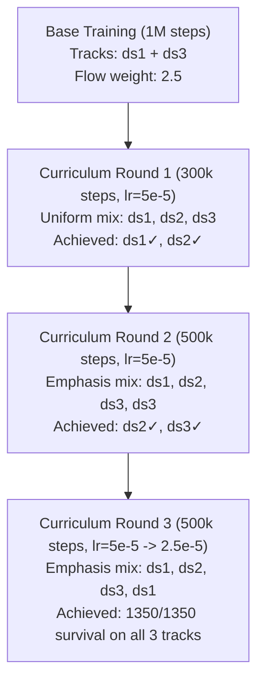

# Mario 64 DS - Reinforcement Learning (Slide Tracks & Vertical Clock Ascent)

This project is a Deep Reinforcement Learning implementation that trains autonomous artificial agents to navigate Super Mario 64 DS — mastering both downhill slide courses and 3D vertical platforming stages (Tick Tock Clock) — operating natively through a Nintendo DS emulator.

**Tracks (savestates located in `data/`):**
- `ds1` — Cool, Cool Mountain slide (penguin slide)
- `ds2` — Princess Peach's Secret Slide (The Princess's Secret Slide)
- `ds3` — Tall, Tall Mountain secret slide (Monkey slide)
- `ds8` — Course 14 full ascent (Tick Tock Clock / Slow setting)
- `ds9` — Course 14 star jump test platform (Tick Tock Clock)

---

## 🎥 Watch a decision being made


One deterministic 1350-decision episode per track, recorded by
`scripts/record_dashboard.py` under the [`rust/`](rust/README.md) supervisor
(`--supervisor rust --parallel 3`). Every figure below is what the clip itself
displayed, and `tools/check_readme_numbers.py` re-derives each cell from
`videos/dashboard/dashboard_*.json` — including the $\times 2.5$ column, which is
recomputed from the logged weight-free flow sum rather than copied.

| Track | Steps survived | R at flow $\times 1.0$ (single recorded episode) | R re-priced at $\times 2.5$ | Fast-fall clamps (not falls) | Near-stationary decisions | Clip |
|---|---|---|---|---|---|---|
| `ds1` (Cool, Cool Mountain) | 1350 / 1350 | +131.77 | +369.94 | 2 | 695 | [dashboard_ds1.mp4](videos/dashboard/dashboard_ds1.mp4) — 90.0 s, 60 fps, policy on cpu |
| `ds2` (Peach Slide) | 1350 / 1350 | +329.92 | +865.29 | 1 | 226 | [dashboard_ds2.mp4](videos/dashboard/dashboard_ds2.mp4) — 90.0 s, 60 fps, policy on cpu |
| `ds3` (Monkey Slide) | 1350 / 1350 | +185.40 | +504.01 | 3 | 298 | [dashboard_ds3.mp4](videos/dashboard/dashboard_ds3.mp4) — 90.0 s, 60 fps, policy on cpu |

**Where the video is.** All three full clips live in
[`videos/dashboard/`](videos/dashboard) next to the JSON each run wrote about
itself (`dashboard_<track>.json`) and its per-decision trace
(`dashboard_<track>_trace.json`). The animation at the top is the closing 10 s
of `ds1` as an inline GIF, because GitHub strips `<video>` from README markdown
and serves repository `.mp4` as a download rather than a stream — the links above
open the real 90-second, 60 fps files.

**What "1350 / 1350" does and does not mean in the historical baseline.** In the original visual-only baseline environment, there was no finish-line detector: an episode ended either on the black-screen death or on the horizon, so surviving all 1350 decisions was the repo's original completion criterion, not a verified traversal. (The modern environment architecture now implements full 3D finish-line and star completion detection via RAM coordinates; see §"3D Proximity & RAM State Architecture"). The per-decision traces (`videos/dashboard/dashboard_*_trace.json`) make the difference visible — on `ds1` the agent is nearly stationary (speed below 0.5 track units in magnitude) for **695** of the 1350 decisions and gets zero forward flow for 585 of them, yet still scores +131.77, because the flow reward pays for sliding and the step cost is only 0.02. Most of those stationary decisions come after the finish: Mario drops into the end room at decision 605 and stands there until the horizon (see *Measured against the RAM finish line* below). The "fast-fall clamps" column counts entries of the RAM word `0x0217F760` into its $-75$ clamp, which happens on any long drop: on `ds1` the second one is the drop through the exit hole into the end room. They are not falls into the void; none of these runs falls below its course's `kill_y`.

### ⚠️ One checkpoint, two outcomes: `ds3` depends on the arithmetic

The same `curriculum_flow25_r3_best.zip`, same savestate, same deterministic
policy, with the torch device as the only variable
([`results/device_divergence.json`](results/device_divergence.json), measured
2026-10-12):

| Track | policy on cpu | policy on cuda | first divergent decision |
|---|---|---|---|
| `ds1` | 1350 steps, +131.77 | 1350 steps, +131.77 | none (identical action sequences) |
| `ds2` | 1350 steps, +329.92 | 1350 steps, +329.92 | none (identical action sequences) |
| `ds3` | **1350 steps, +185.40** | **218 steps, -3.06 (died)** | 33 |

On `ds3` the two arms part company at decision **33**, where the gap between the
top two action probabilities was **0.000325** — and the GPU trajectory ends in
the abyss at decision 218. So the published `ds3` benchmark is real and
reproducible, but only on the CPU instrument (which is what `src/eval.py` and
these recordings use); the checkpoint's competence on that track rests on a
three-in-ten-thousand margin, not on a robust racing line. `tools/probe_device_divergence.py`
re-runs all six arms.

The recordings, the traces and the supervisor's own parity report
([`results/supervisor_parity.json`](results/supervisor_parity.json): Python
22.2 s, Rust sequential 21.8 s, Rust `--parallel 3` 9.0 s → **2.42×**, 3/3 tracks
identical on 11 compared fields, over-budget worker killed at 12 s, ROM and
battery hashes unchanged) are all regenerable with:

```bash
python scripts/record_dashboard.py --supervisor rust --parallel 3
python tools/parity_supervisor.py --steps 40
python tools/probe_device_divergence.py
python tools/check_readme_numbers.py        # gate: prose must equal the artifacts
```

---

## 🎯 Objective
The agent's primary objective is to **complete each stage** — traversing the full descent in the slide courses and ascending the vertical clock tower in Tick Tock Clock to collect the Power Star (not merely survive by idling) — navigating forward and upward using raw visual observations alongside 3D spatial progression rewards. Slide episodes are configured for `1350` steps (90 seconds at emulator frameskip 4) — the previous 30s limit was insufficient to traverse the full geometry of any track. Tick Tock Clock `v4` uses `3000` steps (200 s), because the recorded human ascent took 2,674 decisions.

---

## 🏆 Current Benchmark State: `ds1` and `ds2` finished, `ds3` not

**`curriculum_flow25_r3_best.zip`** (PPO + NatureCNN, optical flow weight $\times 2.5$) — the first agent checkpoint in the project's history to survive the full 1350-decision horizon on all 3 slide tracks, corroborated by independent deterministic evaluation (9/9 full 90-second episodes). "Completed Steps" below means surviving the horizon; the finish-line check that follows shows that it reaches the end of `ds1` and `ds2` but not of `ds3`:

| Track | Reward (video, flow $\times 2.5$) | Completed Steps | Demonstration Video |
|---|---|---|---|
| `ds1` (Cool, Cool Mountain) | +369.94 | **1350 / 1350** | `videos/phase_ds1.mp4` |
| `ds2` (Peach Slide) | +865.29 | **1350 / 1350** | `videos/phase_ds2.mp4` |
| `ds3` (Monkey Slide) | +504.01 | **1350 / 1350** | `videos/phase_ds3.mp4` |

**Instrument.** Those numbers were produced with the policy evaluated on the
**CPU** — `src/eval.py` loads the checkpoint with SB3's default device handling,
and on this machine that detail decides `ds3`: the same weights on the GPU die at
decision 218 (see *One checkpoint, two outcomes* at the top). The three
deterministic evaluation episodes per track come out identical, so the published
mean is one trajectory replayed three times, and the dashboard recordings at the
top of this file reproduce each of these cells to the cent.

> **Measured against the RAM finish line (2026-11-04).** [`scripts/eval_finish_line.py`](scripts/eval_finish_line.py)
> replays the checkpoint deterministically on CPU (horizon 2000). The finish is
> the end area measured from each finish savestate (`TRACK_GOALS` `finish_region`
> in `src/ram_state.py`: the `ds1` end room, the `ds2` area past the checkered
> line, where the in-game timer stops); a death is a fall below the course's
> `kill_y`:
>
> | Track | Outcome | Falls below `kill_y` |
> |---|---|---|
> | `ds1` (Cool, Cool Mountain) | **finish** at decision 605 | 0 |
> | `ds2` (Peach Slide) | **finish** at decision 739 | 0 |
> | `ds3` (Monkey Slide) | not finished: stuck on a flat section at $Y = 7{,}179$ from decision ~140, closest 23,979.7 of 36,403.6 | 0 |
>
> **Two corrections to the 2026-11-03 version of this table**, which said `ds1`
> was not finished and that the policy died at decisions 66, 836 and 38 once
> falls ended the episode. (1) The finish was a 250-unit radius around one
> point; the `ds1` end room extends 1,046.6 units from it, and Mario stood in it
> 417.5 units away. (2) "RAM death" used the `0x0217F760` clamp, which fires on
> every long drop, including the drop through the `ds1` exit hole into the end
> room (decision 599) and drops on the slides themselves; in Tick Tock Clock the
> real fall off the start platform crosses `kill_y` on the same frame the clamp
> fires, so the position rule loses nothing. The environment now uses the
> position rule (`death_rule="position"`; `"struct"` reproduces the old one).
> Results: `results/finish_line_curriculum_flow25_r3_best.json`; dashboards under
> these rules: [`videos/dashboard_finish/`](videos/dashboard_finish).

To re-record the demonstration videos:
```bash
python scripts/record_phases.py --model models/curriculum_flow25_r3_best.zip
python scripts/record_dashboard.py --supervisor rust --parallel 3   # annotated 60 Hz
```

### 🏁 What the corrected finish line changed, and the remaining track

| Controller | `ds1` | `ds2` | `ds3` |
|---|---|---|---|
| PPO `curriculum_flow25_r3_best` | finish at decision 605 | finish at decision 739 | horizon, closest 23,979.7 |
| world-model head `wm_mario64ds_mem` | finish at decision 657 | finish at decision 729 | horizon, closest 23,979.7 |
| PPO `curriculum_finish_r4_best` | falls at 374, closest 4,681.2 | finish at decision 627 | ended at 115 by the black-screen rule, closest 28,978.2 |

`curriculum_finish_r4` was fine-tuned from r3 (700k steps, horizon 2000,
progress reward and $+200$ at the finish) **under the old clamp rule**, so it
was punished for legitimate drops, and on the old 250-unit finish. Measured
with the corrected rules it finishes `ds2` faster but really falls on `ds1`
where r3 does not, so r3 remains the reference checkpoint. The historical
environment (black-screen death only) gives the same outcomes, except that it
detects r4's `ds1` fall 12 decisions later (386); see
[`results/finish_line_*.json`](results).

**`ds3` is the open problem**, and it is not about falling: every controller
reaches the same broad, nearly flat sandy section ($Y = 7{,}179$, from decision
~140) and wanders there, 20,000 units above the finish, without finding the way
on; braking before it ends there too. An automatic search without a human
([`scripts/explore_slide.py`](scripts/explore_slide.py): 48 policy rollouts with
random perturbations per stage, branched from savestates, keeping the furthest
point survived for 40 more decisions) left that section and brought the
distance from 26,368.5 to 14,592.8 in 4 stages, but along a dead end: the
surface ends at a skull sign at $Y pprox 193$ and all 48 branches of the next
3 stages fell into the void. Greedy distance to a finish 20,000 units below is
not a reliable guide on this course.

Training more, with an exploration bonus instead of the distance reward, did
not find another way either (`ds3_explore_r5`, 2026-11-04): 600k steps from r3
on `ds3` only, flow 0, no distance reward, $+500$ at the finish, a count-based
bonus $1/\sqrt{N}$ per 400-unit cell (none in free fall, which otherwise paid
falls through the void as exploration), checkpoints every ~100k. No checkpoint
finished; greedy on CPU they reached at best 15,237.1 from the finish, at ~599k
steps, along the same dead-end route, before dying at decision 399, and the
final model stays on the flat section (closest 23,999.8)
([`results/ds3_explore_r5_checkpoints.json`](results/ds3_explore_r5_checkpoints.json)).
**Following the coins.** The course's coins trace its path, and the coin
counter is now read from RAM (`0x02098998`, the only word matching the HUD over
a `ds3` run; `ram_coin_reward` in the env, `--coin-reward` in `train_curriculum`).
The same search scored by coins collected instead of distance
([`results/ds3_searches.json`](results/ds3_searches.json)) went from 15 coins to
at most 21, and the frames show why it stops: at that point a red arrow points
right, to a wooden plank path carrying coins, while Mario stays on the sand
beside it and drifts towards the skull. From there every rollout died (96 of 96
per stage, also with random actions held up to 30 decisions and with combined
direction+jump actions). The coins mark the way; neither the policy nor random
perturbations of it get onto that path.

**Systematic move sweeps** ([`scripts/sweep_moves.py`](scripts/sweep_moves.py),
[`results/ds3_sweeps.json`](results/ds3_sweeps.json)) then tried every held
action and every turn-then-jump/run pair from savestates just before each such
spot, followed by the policy. At the arrow, 2 of 1,728 openings survive, both
"up+right for 16 decisions, then B": that is the way onto the plank path. From
there the coin search and two more sweeps followed the coins to 36 and to
4,517.3 units from the finish, where a narrow path ends above a shaft; no
attempt survives it (0 of 2,160, 0 of 1,728 and 0 of 2,160), nor any of 90 long
jumps (R+B while running, which the action sets lack). The falls there are real:
Mario drops below $Y = -18{,}000$ and the game respawns him with the coin count
reset. `ds3` is therefore still not finished, and the remaining obstacle is
this one gap.

**Is the gap just a matter of training?** Frames show the sandy path ending at
a brick tower with a dark doorway; Mario arrives airborne at full speed, passes
beside the doorway and falls along the tower; braking for up to 16 decisions
does not stop him on the slope. Training PPO from r3 only from 8 savestates
just before it (decisions 690-720 of the found route; 200k steps, about 5,373
episodes, coin reward and $+500$ at the finish,
[`results/ds3_gap_training.json`](results/ds3_gap_training.json)) did not
learn it: training episodes kept averaging 32.9-40.6 decisions with return
$-99.0$ to $-97.6$, and r3 and every checkpoint fall from all 8 savestates
(0/8). Together with the sweeps, that is more than 11,000 attempts from right
before the gap without one success. This is *inconclusive* about longer
training, not evidence against it: 200k steps is small for a problem where the
sweep found the passing opening in 2 of 1,728 tries.

**Can the agent reach the gap on its own, from coins alone?** Not yet
(`ds3_coins_r7`, [`results/ds3_coins_r7.json`](results/ds3_coins_r7.json)).
r3 was expanded to the 12 compound actions (all weights kept; legacy logits
identical to $1.9 	imes 10^{-6}$) and trained 1M steps from the `ds3` start
only, with $+1$ per coin read from RAM, $+500$ for reaching the gap
(radius 600 around 6,432 / -11,263 / -11,499), no distance reward. No
checkpoint reached it: the greedy final model collects $+12$ coins and gets to
14,794.7 from the gap goal before falling (the skull route), the checkpoint
chosen by evaluation stays on the flat section (23,041.6), and none of 11
sampled episodes of the final model came closer than 13,968.1; the plank path
after the red arrow was never entered. The searches reached it with scripted
moves, so what the agent lacks is exploration of that one manoeuvre. 1M steps is
a small budget (comparable work uses tens to hundreds of millions), so this
does not show that longer training would fail.

**Longer, with the route as start states (`ds3_route_r8`, PPO, 3M steps,
[`results/ds3_route_r8.json`](results/ds3_route_r8.json)).** Continued from
the coin-only model, with 75% of the episodes reset to one of 49 savestates along
the found route (decisions 0-720), same rewards. Twelve checkpoints (every 250k
steps) and the final model were evaluated greedy from the four savestates just
before the red arrow (decisions 300-345) and from the start. The arrow was
passed in 1 of 52 arrow-state evaluations: the 500k-step checkpoint, from the
decision-345 savestate, reached the gap goal (550 from its centre, +10 coins);
the same savestate failed at every later checkpoint and the other three never
passed. From the real start no checkpoint passed the arrow; the closest was
14,951.9 from the goal (final model), along the skull route that the policy
converged to instead of the planks.

**The same with QR-DQN + IMPALA (`qrdqn_ds3_route`, 1M steps,
[`results/qrdqn_ds3_route.json`](results/qrdqn_ds3_route.json)).** Same
savestates and rewards, plus the found route as a replay demonstration (717
decisions, 10 copies at the start and one more every 10k steps, about 7% of the
buffer) and exploration that holds a random action for up to 16 decisions.
Evaluated every 100k steps: no checkpoint reached the gap goal from any of the
four arrow savestates (0 of 40). The best was the 100k checkpoint from the
decision-345 savestate: +12 coins and 7,537.1 from the goal before dying at
decision 426, the closest of any non-passing run, but it was not repeated from
200k to 1M steps. From the start the arrow was not passed either; the closest
was 15,658.4 (800k), by the skull route. Neither algorithm has learned the
manoeuvre, although the demonstration contains it.

**Cloning the demonstration (`scripts/clone_demo.py`,
[`results/ds3_bc_demo.json`](results/ds3_bc_demo.json)).** Cross-entropy on the
demonstrated action (1,481 samples: the continuous replay plus the next 16
decisions from each of the 49 route savestates), PPO network of the 12-action
policy, 60 epochs (train accuracy 0.999). The clone passes the red arrow and the
planks: from the real start it follows the route for 671 decisions, collects 21
coins and gets to 5,137.6 from the gap goal, the first agent to pass the arrow
from the start; from each of the four arrow savestates it ends at the same place
(decision 671 of the route). It still dies there, 46 decisions short of the goal
(0 of 4 reach it; 12 of 49 route savestates do, those after decision 671), and
it is not robust: with 3-8 random actions before it takes over, 0 of 20 runs
reach the goal. It reproduces one trajectory; it has not learned the course.

**Is an image-based "coin centred on screen" reward usable on `ds3`?**
`scripts/probe_coin_detector.py`
([`results/ds3_coin_detector.json`](results/ds3_coin_detector.json), overlay in
[`results/ds3_coin_detector.png`](results/ds3_coin_detector.png)) replays the found
route (2,868 frames, 28 collection events by the RAM coin counter) and compares four
colour detectors with it. Every variant sees a blob before each collection (28 of
28), so recall is not the problem. The signal is: the original yellow mask is
positive in every frame because of the HUD coin icon, with the HUD masked it is still
positive in 94.6% of frames (sand and wooden planks sit next to yellow in hue), and
the strictest variant (round blobs only) fires in 25.2% of frames but typically only
at the last frames before a collection (median lead 0 frames, 75th percentile 6),
which is no better than the collection reward itself. The coins of the plank path at
the red arrow are small and olive-coloured on the sand and are mostly missed by it.
A colour detector is therefore not a reliable long-range "coin ahead" signal here.

**Template matching instead of colour**
(`scripts/probe_coin_template.py`, [`results/ds3_coin_template.json`](results/ds3_coin_template.json),
[`results/ds3_coin_template_game.json`](results/ds3_coin_template_game.json)) on the same
2,868 frames. With the coin picture of `images/coins.png` at eight scales, the score
threshold trades recall for noise: at 0.6 it is positive in 97.6% of frames, at 0.7 in 60.7%
with a median lead of 6 frames, at 0.8 it finds 2 of 28 collections. With templates cropped from the game itself
(training on 14 collection events, scoring the other 14) all 14 are found at 0.6, 0.7 and 0.8,
but the detector is positive in 100.0%, 96.4% and 56.2% of frames, and at 0.8 the median lead
is 4 frames. The image detectors find the coins but do not say which one to go for, so no
image-based coin signal was usable on `ds3`.

**PPO fine-tune of the clone** (`scripts/run_ds3_finetune.sh`,
[`results/ds3_finetune.json`](results/ds3_finetune.json)): value-head warm-up for 100k steps
with the policy frozen, then 700k steps at learning rate 1e-5, `target_kl` 0.02, clip 0.1, no
entropy bonus, resets on route and arrow savestates. After the warm-up the agent is the clone (dies at decision 671,
0 of 4 arrow states reach the goal). Once the policy updates it gets worse: at 800k steps it
dies after 210 decisions from the real start with 5 coins, 0 of 4 arrow states reach the goal
and 2 of 4 hard-spot states do. PPO did not improve the clone.

A single human run would provide the route (as for Tick Tock Clock): double-click `record-ds3.bat` (the recorder now also
accepts the slide finish as a completed run), then
`python scripts/prepare_human_route.py <attempt> --out config/routes/ds3_human_v1.json --checkpoint-dir data/curriculum/ds3_human_v1`.

```bash
python scripts/eval_finish_line.py --controller ppo --model models/curriculum_flow25_r3_best.zip --max-steps 2000
python scripts/eval_finish_line.py --controller mem --model models/wm_mario64ds_mem.pt --max-steps 2000
python scripts/record_dashboard.py --model models/curriculum_flow25_r3_best.zip --tracks ds1,ds2,ds3 \
    --max-steps 2000 --use-ram-death --dist-reward --out-dir videos/dashboard_finish
```

### 📦 Model assets (a clean clone does not contain them)

The checkpoints are large and are **not committed**; the commands above expect
them under `models/`. The versioned contract for those bytes (role, size,
SHA256) is [models/ASSETS.json](models/ASSETS.json), documented in
[docs/MODEL_ZOO.md](docs/MODEL_ZOO.md). Download the release/LFS assets, or
train them with the commands below, then verify:

```bash
python tools/verify_assets.py             # report present / missing / hash mismatch
python tools/verify_assets.py --require   # fail when a required asset is absent
```

The same applies to the world-model bundles and the base replay buffer. The
experiment artifacts and their known provenance gaps are listed in
[results/MANIFEST.md](results/MANIFEST.md).

---

## 🧭 Theoretical Analysis: The Complete Causal Chain

Achieving simultaneous convergence across all three tracks required resolving five interconnected failure modes, where each experimental discovery falsified earlier hypotheses:

**1. The coin tracking reward was structurally defective (legacy BGR bug).**
The internal display buffer exported by `py-desmume` is structured as **BGR(X)**, rather than RGBX as initially assumed. Applying OpenCV's `COLOR_RGB2HSV` conversion directly to BGR data caused a phase rotation of the hue channel ($H \to 120 - H$). Consequently, the yellow color mask ($H \in [15, 40]$) filtered for **cyan** features ($H \approx 90 \to 30$), entirely missing actual gold coins ($H \approx 25 \to 95$). **All historical convergence was carried solely by optical flow** (see §"Color Representation Bug" below).

**2. Naive coin reward correction triggered severe reward hacking.**
Once the BGR ordering was corrected, the yellow HSV mask began registering high-confidence false positives on the **checkered floor** (bottom image slice) and the **flower-textured side walls** (which pulled the agent toward the outer left edge). The agent maximized return by centering noise features instead of navigating. Fix: **Coin reward disabled by default** (`coin_reward_enabled=False`).

**3. Low optical flow weighting ($\times 0.5$) failed to counteract terminal death penalties.**
Without the accidental heuristic baseline of the legacy coin detector, **fresh policy initializations degraded rapidly** (mean episode reward shifted from $-73.9$ to $-89.3$, terminal death occurred within $\sim 55\text{--}119$ steps, with 0 timeouts). In stochastic rollouts where policy exploratory entropy leads to falls, dense forward momentum reward must dominate the $-100.0$ abyss penalty. Fix: **`flow_weight=2.5`** (shifting policies from collapsing at step $\sim 90$ to full survival on `ds1` at 1350/1350).

**4. Camping behavior and horizon truncation.**
Given survival-only incentives, policies converged to safe non-sliding plateaus on `ds3` (idling indefinitely without forward progression). Furthermore, a 30s horizon (450 steps) truncated episodes prior to track completion. Fixes: Fixed temporal cost **`step_penalty=0.02` per step** (idling incurs $\sim -27.0$ across 1350 steps, incentivizing rapid progression) and extending the horizon to **`max_steps=1350` (90s)**.

**5. Multi-track interference resolved via alternating curriculum.**
Simultaneous multi-task training across all three tracks at high learning rates ($\eta = 3 \times 10^{-4}$) induced catastrophic interference within the shared convolutional feature representations (Experiment A lost `ds1`; Experiments C/D failed to converge even after 2M steps). The solution combined:
- **Decaying learning rates** ($5 \times 10^{-5} \to 2.5 \times 10^{-5}$) to constrain parameter displacement and preserve consolidated skills;
- **Balanced checkpoint selection** using multi-track deterministic evaluation (single-track specialists yield poor average returns across tracks);
- **Curriculum with alternating track sampling emphasis**:

| Round | Track Mixture | `ds1` | `ds2` | `ds3` | Timestamp |
|---|---|---|---|---|---|
| Base | `ds1`, `ds3` (flow $\times 2.5$, 1M) | **✓ 1350** | ✗ 228 | ✗ 81 | 2026-09-17 |
| r1 | Uniform mix (`ds1`, `ds2`, `ds3`) | ✓ 1350 | **✓ 1350** | ✗ 359 | 2026-09-17/18 |
| r2 | `ds3`-heavy (`ds1`, `ds2`, `ds3`, `ds3`) | ✗ 455 | ✓ 1350 | **✓ 1350** | 2026-09-18 |
| **r3** | **`ds1`-heavy** (`ds1`, `ds2`, `ds3`, `ds1`) | **✓ 1350** | **✓ 1350** | **✓ 1350** | **2026-09-18** |

Each training round initially consolidated one track at the expense of another; round `r3` successfully balanced the representations across all three tracks simultaneously.

---

## 🧠 System Architecture

- **Emulation Layer**: `py-desmume` (Python wrapper interfacing with the DeSmuME C++ core).
- **Environment Interface**: Custom `gymnasium.Env` (`src/env.py`).
- **State Representation**: Grayscale frames resized to $84 \times 84$, stacked via `FrameStack` ($k=4$) to supply temporal velocity and acceleration dynamics to the neural networks.
- **Reinforcement Learning Algorithms**:
  - **Rainbow DQN** (Tianshou framework, `src/train.py`) utilizing **IMPALA CNN** (`src/impala_cnn.py`) or **NatureCNN** (`--features nature`).
  - **PPO** (Stable-Baselines3, `src/train_ppo.py`) with standard **NatureCNN** or custom **IMPALA** (`src/sb3_impala.py`).
  - **QR-DQN** (sb3-contrib, `src/train_qrdqn.py`) supporting both NatureCNN and IMPALA feature extractors.
- **Experiment Tracking**: `MLflow` (SQLite backend `mlflow.db`) + `TensorBoard` (`tensorboard_logs/<run-id>`).
- **Evaluation Engine**: `src/eval.py` ($N$ deterministic/stochastic episodes, fixed seeds, CSV exports).
- **Video Rendering**: `scripts/record_phases.py` (real-time RGB MP4 per track) and `scripts/record_dashboard.py` (annotated 60 Hz dashboard: gameplay, CNN input, flow window, $\pi(a|s)$, critic value, RAM struct, reward instrument; plus a per-decision trace JSON).
- **Process Supervision**: `rust/sm64_sup.exe` (std-only Rust; one process per track because two DeSmuME cores in one process crash, with live streaming, per-run budget, kill on overrun and result collection — see [`rust/README.md`](rust/README.md)).
- **Evidence Tooling**: `tools/parity_supervisor.py` (Rust vs Python orchestration arms), `tools/probe_device_divergence.py` (cuda/cpu action-sequence study), `tools/profile_step.py` (where a step's milliseconds go), `tools/check_readme_numbers.py` (re-derives every figure quoted here).
- **3D Proximity & RAM State Architecture**: Exact spatial coordinates ($X$: `0x0217F714`, $Y$: `0x0217F718`, $Z$: `0x0217F71C`), death detection by position (Y below each course's `kill_y`; the `0x0217F760` fast-fall clamp is kept only as `death_rule="struct"`), course ID extraction (`0x02285238`), and star collection detected when Mario is within $80$ units of the star, or when the star counter (`0x0209FB64`) rises while he is within $500$ units (the counter alone fluctuates; see §10.6 of the reward doc). Detailed documentation in [`docs/REWARD_SYSTEM_AND_RAM.md`](docs/REWARD_SYSTEM_AND_RAM.md).
- **Human Demonstrations**: `scripts/record_human.py` / `record-ttc.bat` (interactive 60 Hz recorder, any button combination, per-frame masks, checkpoint savestates) and `scripts/prepare_human_route.py` (frame-exact replay check, loop-erased route, curriculum checkpoints); consumed by `src/route.py` (route progress reward) and `src/demos.py` (replay-buffer prefill). See [`docs/HUMAN_RECORDING.md`](docs/HUMAN_RECORDING.md).
- **Benchmark Grid Orchestration**: `scripts/run_grid_100k.py` (executes controlled 18-configuration algorithmic grids).
- **Curriculum Pipeline**: `src/train_curriculum.py` (multi-phase fine-tuning with learning rate decay and balanced multi-track validation).
- **Consolidated Empirical Data**: `results/` (stores consolidated experimental CSV tables for 100k grid, 500k scale, 2M steps, and curriculum rounds).

---

## 🚀 Engineering Challenges & Solutions

### 1. Emulator Memory Access Violations
- **Issue**: Parallel vectorized rollout environments (such as PPO multi-env setups) caused segmentation faults (`Access Violation`) when instantiating multiple DeSmuME C++ instances within a single Python process.
- **Solution**: Implemented process isolation via `SubprocVecEnv` (both in SB3 and Tianshou). Each emulator instance operates inside its own OS-level process, communicating observations and actions via inter-process pipes.

### 2. Prioritized Experience Replay Memory Exhaustion (OOM)
- **Issue**: Standard 100k-capacity `PrioritizedVectorReplayBuffer` allocations with multi-frame image stacks ($4 \times 84 \times 84$ `uint8`) exceeded 26 GiB of RAM due to deepcopy semantics within Tianshou.
- **Solution**: Bounded replay buffer capacity to `20,000` transitions and streamlined frame processing, stabilizing memory consumption at $\sim 1.5$ GB without compromising off-policy sample quality.

### 3. Optical Flow Computation Overhead
- **Issue**: Computing Farneback optical flow (`cv2.calcOpticalFlowFarneback`) at full resolution severely degraded environment throughput.
- **Solution**: Downscaled observation slices specifically for optical flow calculation to $32 \times 32$. This maintained high simulator FPS while preserving robust directional motion estimation.

### 4. Sparse Reward Collapse & Local Optima ("The Wall Strategy")
- **Issue**: When removing optical flow rewards, policies relied exclusively on sparse coin rewards. The agent quickly discovered a local optimum: steering hard left to drop off the track immediately, collecting a small coin cluster near the barrier and terminating with a $-28.0$ return rather than risking $-50.0$ further downhill.
- **Solution**: Reintroduced dense optical flow incentives ($y$-component forward motion), reinforcing forward progress over abrupt lateral suicide.

### 5. The Suicide Paradox
- **Issue**: An earlier reward specification penalized timeouts ($-100.0$) more heavily than falling into the abyss ($-50.0$). The agent learned to deliberately jump off cliffs upon reaching the lower track sections to terminate early and avoid the larger timeout penalty.
- **Solution**: Aligned reward incentives: timeout penalty set to $0.0$ (reflecting survival), while falling off the track incurs a severe $-100.0$ penalty ($R_{\text{death}} < R_{\text{timeout}}$).

### 6. Visualizer Tensor Mismatch
- **Issue**: `play.py` originally provided observations with incompatible 5D tensor shapes, causing policies to receive out-of-distribution inputs and execute degenerate single-action trajectories.
- **Solution**: Refactored the visualization pipeline to use official vectorized wrapper pipelines (`DummyVecEnv` + `VecFrameStack` + `VecTransposeImage`), ensuring identical input tensor shapes between training and evaluation.

### 7. Goal Completion vs. Survival Fallacy (3D Progress Reward Shaping)
- **Issue**: Survival-only optimization ($R_{\text{timeout}} = 0$, $R_{\text{death}} = -100$) incentivized safe idling/camping and could not verify whether an agent surviving 1350 steps reached the course terminus or merely idled. In addition, symmetric potential differences ($D_t - D_{t+1}$) created in-place jumping exploit loops under discounted Q-learning ($\gamma < 1$).
- **Solution**: Implemented monotonic high-water mark progression reward shaping ($r_{\text{dist}} = w_{\text{dist}} \max(0, D_{\min} - D_t)$) based on Mario's exact 3D coordinates in RAM (`0x0217F714`-`0x0217F71C`), terminating upon crossing goal thresholds with a completion bonus ($+200.0$ for slide finishes, $+500.0$ for Tick Tock Clock star collection gated by $D \le 500.0$). Full mathematical derivations and RAM maps in [`docs/REWARD_SYSTEM_AND_RAM.md`](docs/REWARD_SYSTEM_AND_RAM.md).

### 8. RAM-Based Death Detection
- **Issue**: Visual death detection via black-screen thresholding has a long latency: in Tick Tock Clock the screen goes black 122 frames after Mario falls past the course floor (frame 290 vs 168).
- **First solution, withdrawn 2026-11-04**: treat the `0x0217F760 <= -300000` clamp as death. That word clamps on any long drop, including the legitimate drop into the `ds1` end room and drops on the slides, so it produced false deaths (the `ds1`/`ds2`/`ds3` "deaths" at decisions 66, 836 and 38 of the earlier finish-line table).
- **Current solution**: a fall below the course's lowest floor (`kill_y` in `TRACK_GOALS`), which in Tick Tock Clock fires on the same frame as the clamp; the black screen stays as a fallback.

### 9. Savestate Management & External Asset Distribution
- **Issue**: Cold-booting the ROM for each episode reset consumes $\approx 1700\text{--}2400\text{ frames}$ ($28\text{--}40\text{ seconds}$), making RL training intractable across $10^5$ episodes ($>40$ days of idle boot time). Savestates reduce reset latency to $<2\text{ ms}$, but cannot be committed to Git due to proprietary RAM dumps and repository bloat.
- **Solution**: Developed [`scripts/manage_states.py`](scripts/manage_states.py) for automated RAM verification, cryptographic SHA-256 validation, and external bundling. Published savestates for courses `ds1`, `ds2`, `ds3`, `ds8`, and `ds9` under GitHub Release [`v1.1.0`](https://github.com/PedroM2626/mario64ds-rl/releases/tag/v1.1.0). Terminus states `ds4`, `ds5`, and `ds6` were eliminated entirely from runtime by hardcoding finish coordinates in [`src/ram_state.py`](src/ram_state.py).

---

## 📊 Historical Benchmark Results

### Initial 450-Step Regime (30 Seconds, Legacy Configuration)

Initial experiments evaluated policies over 450 steps ($30\text{s}$) with single-episode stochastic evaluations:
- **500k Steps (PPO baseline)**: Achieved survival through step $449/450$, collecting $+148.0$ points prior to a late fall (net $+48.10$).
- **1M Steps (PPO continued via `--resume`)**: Reached the 450-step timeout on `ds1` ($+144.24$) and `ds2` ($+102.85$).
- *Reproducibility Note*: These historical figures reflected single stochastic rollouts without fixed seeds. Systematic evaluations were formalized under `src/eval.py`.

### 100k Controlled Benchmark Grid (CPU Baseline)
Evaluating `(PPO, Rainbow, QR-DQN) × (NatureCNN, IMPALA) × Seeds {0, 1, 2}` over 100k timesteps (`results/results_grid_100k.csv`):

| Algorithm × Extractor @ 100k | Mean Reward $\pm$ SD | Mean Survival Rate | Mean Training Duration | Status |
|---|---|---|---|---|
| **Rainbow + NatureCNN** | **+7.20 $\pm$ 2.99** | **0.50** (3/6 across all seeds) | $\sim 4.5\text{h}$ | 3/3 Converged |
| **PPO + NatureCNN** | -47.03 $\pm$ 32.68 | 0.17 (Seed 0: 3/6) | $\sim 35\text{min}$ | 3/3 Converged |
| **PPO + IMPALA** | -53.62 $\pm$ 36.74 | 0.17 (Seed 1: 3/6) | $\sim 52\text{min}$ | 3/3 Converged |
| **QR-DQN + IMPALA** | -46.55 $\pm$ 24.05 | 0.17 (Seed 1: 3/6) | $\sim 60\text{min}$ | 3/3 Converged |
| **QR-DQN + NatureCNN** | -62.28 $\pm$ 8.98 | 0.00 | $\sim 40\text{min}$ | 3/3 Converged |
| **Rainbow + IMPALA** | -75.83 $\pm$ 0.07 | 0.00 | Aborted (OOM) | Failed (`ArrayMemoryError` in PER deepcopy) |

*Key Findings*:
1. Rainbow with NatureCNN exhibited the highest consistency at 100k steps across all three random seeds.
2. PPO and QR-DQN showed high seed sensitivity at short training horizons, overfitting to one savestate while failing the other.
3. At 100k steps, single-track specialization dominated; multi-track generalizability required longer horizons and structured curricula.

*Effective sample size*: the "3 episodes" per track here are the same
deterministic rollout repeated three times, not three independent trials. The
committed CSV has 108 rows but only 36 unique (run, track, reward, steps)
trajectories; the new `src/eval.py` JSON reports `n_unique` and a Wilson
interval so this is visible at the point of use. See
[results/MANIFEST.md](results/MANIFEST.md).

### 500k Regime Scaling & Generalization
Increasing training to 500k timesteps on two tracks (`ds1` + `ds3`) tested whether scale broke single-track specialization (`results/results_grid_500k.csv`):

| Configuration | `ds1` (3 eps det.) | `ds2` (3 eps det.) | `ds3` (3 eps det.) | Overall Survival |
|---|---|---|---|---|
| **PPO + NatureCNN (500k, Seed 0)** | **+100.36 (450/450)** | **440/450 (98% progress)** | **+55.07 (450/450)** | **6/6 (100% on training tracks)** |
| **Rainbow + NatureCNN (500k)** | +90.77 (450/450) | -63.41 (201 steps) | -37.78 (357 steps, 79%) | 3/9 |

*Zero-Shot Generalization*: The 500k PPO agent, trained strictly on `ds1` and `ds3`, completed 98% of `ds2` (Peach Slide) on its very first evaluation without prior gradient updates on that track.

> **Provenance note.** The committed [results_grid_500k.csv](results/results_grid_500k.csv)
> contains only `ds1` and `ds3` rows. The `ds2` 440/450 cell above came from a
> separate evaluation and is not backed by that CSV; see
> [results/MANIFEST.md](results/MANIFEST.md). Treat it as a historical claim
> until the evaluation is regenerated with the current `src/eval.py`.

---

### Three-Track Generalization Experiments (Pre-Curriculum)

Attempts to train simultaneously on all three tracks using uniform sampling revealed severe interference:

| Experiment | `ds1` | `ds2` | `ds3` | Outcome |
|---|---|---|---|---|
| **A. Fine-tuning** (2-way 500k + `ds2`, $\eta = 3 \times 10^{-4}$) | ✗ 0/3 (-76.99) | **✓ 3/3** (+34.90) | **✓ 3/3** (+60.34) | **Catastrophic forgetting of `ds1`** |
| **B. Fresh 3-way** (500k steps, 3 envs) | ✗ 0/2 (-74.59) | ✗ 0/2 (-44.03) | ✗ 0/2 (-74.93) | Under-trained ($\sim 167\text{k}$/track) |
| **C. Extended 3-way** (1M total steps, 3 envs) | ✗ 0/3 (-60.33) | ✗ 0/3 (-45.94) | ✗ 0/3 (-62.87) | Stochastic survival, 0/3 deterministic |
| **D. Extended 3-way** (2M total steps, 3 envs) | ✗ 420/450 (93%) | ✗ 273/450 | ✗ 203/450 | **0/3 — "More steps alone" hypothesis falsified** |

---

## 🔬 Curriculum Learning & 1350-Step Full Descent

Transitioning from 450 steps to the full track descent (**1350 steps / 90 seconds**) required the alternating curriculum pipeline with decaying learning rates:



### Full Descent Results Summary (`curriculum_flow25_r3_best.zip`)

| Track | Independent Eval (flow $\times 1.0$) | Video Rollout (flow $\times 2.5$) | Descent Steps | Survival Rate |
|---|---|---|---|---|
| `ds1` (Cool, Cool Mountain) | +131.77 | +369.94 | **1350 / 1350** | **3 / 3 (100%)** |
| `ds2` (Princess Peach) | +329.92 | +865.29 | **1350 / 1350** | **3 / 3 (100%)** |
| `ds3` (Tall, Tall Mountain) | +185.40 | +504.01 | **1350 / 1350** | **3 / 3 (100%)** |

---

## 🌍 World Model (Model-Based RL) — fast training via a learned latent model

Adapting the model-based recipe of the research repo
[`smw-pinn`](https://github.com/PedroM2626/smw-pinn) (learn dynamics `f(s,a)→s'`,
train the agent *inside* that model, deploy on the real console) to this
**pixel-only** environment. Full write-up: [`docs/WORLD_MODEL.md`](docs/WORLD_MODEL.md).

The world model was built before Mario's RAM physics struct was found, so its
dynamics are learned from pixels in a **compact latent space** with a Dreamer/PlaNet-style **RSSM world model**
(`src/world_model.py`): convolutional encoder → Gaussian latent + GRU
recurrent state, with prior/posterior, a reward head and a continue head. The
agent is then learned **fast** (`src/train_world_model.py`) from only **~35k real
emulator transitions** collected once (`src/collect_data.py`):

* **imagination RL** (Dyna-style, `src/world_model_agent.py`) — actor-critic
  trained on GPU rollouts inside the frozen model prior (with reference-style
  epistemic pessimism + uncertainty truncation to curb model exploitation); and
* **amortized policy distillation** — a latent actor that clones expert
  full-descent demonstrations inside the learned latent space (stable + fast),
  optionally refined with **interactive DAgger** (`src/dagger_world_model.py`).

The controller that ultimately survives every track distills a **memoryless**
policy head onto the RSSM's learned encoder (`src/distill_memoryless.py`) and
refines it with **memoryless DAgger** (`src/dagger_memoryless.py`).

The deployed policy runs on the live emulator through a belief-state controller
(`src/world_model_controller.py`) or a closed-loop **CEM-MPC** planner
(`src/mpc_world_model.py`), and is recorded/evaluated in real time
(`scripts/record_world_model.py`, `scripts/eval_world_model.py`).

### ✅ The world-model agent survives all three tracks

> **⚠️ Transparency — read this first.** The policy that clears all three tracks
> does **not** discover the skill from scratch through the world model. It is a
> **distillation of the already-trained model-free PPO agent**
> (`models/curriculum_flow25_r3_best.zip`): the PPO's expert descents are provided
> as demonstrations (behaviour cloning) and, via DAgger, the PPO labels the
> student's own states. So the *competence* (the safe racing line) is copied from
> that pretrained PPO — the world model's learned encoder/dynamics only make
> fitting a deployable policy from it **fast** on a tiny buffer. A reader should
> therefore interpret the table below as "the world-model pipeline **reproduces**
> the trained expert and clears all three tracks", **not** "the world model taught
> the agent the stage by itself". The genuinely world-model-native controllers are
> the two negative/limitation results: **imagination RL collapsed** and the
> expert-free **CEM-MPC** clears only 2 of 3 tracks (it is lured off cliffs on ds1
> by the flow reward). See the caveat under *Time saved* for what this does and
> does not demonstrate.

Amortized policy distillation on the world model's learned perception, deployed
memorylessly (no recurrent-belief compounding) and refined with **memoryless
DAgger** (roll out the student, label its own visited states with the expert),
clears **all three** descents in real time (fresh emulator, deterministic), 3/3
every track, with rewards meeting/exceeding the model-free PPO benchmark:

| Track | Real-game result | Reward |
|---|---|---|
| `ds1` (Cool, Cool Mountain) | **3/3 — 1350/1350** | 717 |
| `ds2` (Peach Slide) | **3/3 — 1350/1350** | 550 |
| `ds3` (Monkey Slide) | **3/3 — 1350/1350** | 535 |

Memoryless DAgger lifted ds3 from 65 → 1088 → 1350 steps across rounds. Videos:
`videos/mem_ds1.mp4`, `videos/mem_ds2.mp4`, `videos/mem_ds3.mp4`.

### ⏱ Time saved with the world model

| | Real emulator steps | Wall-clock to a 3-track agent |
|---|---|---|
| Model-free PPO (curriculum) | ~2,300,000 | **~12.2 h** |
| **World model** (collect → fit → distill + DAgger) | **~59,000** | **~30 min** |

**≈ 40× fewer real emulator interactions and ≈ 24× less wall-clock** — the learning
(world-model fit + distillation + DAgger head retraining) runs in ~6 min of GPU
instead of ~12 h of emulator stepping. **What this saving is and is not.** The
~12 h of PPO that *created* the skill is **not** eliminated — the distillation and
DAgger reuse that trained PPO as the demonstration/labelling source (the
reference's amortized-distillation paradigm), so the ~30 min is the cost of
*copying an already-competent policy into a world-model-grounded controller from a
small buffer*, not of learning the stage from zero through the model. The
pure-dynamics **CEM-MPC** controller (no policy net, no expert) is the honest
world-model-only result: it clears 2/3 tracks in real time but is lured over
cliffs on ds1 because the flow reward is hacked by the fast downward motion of
falling.

### 🔬 Can the world model do it *without* an expert? (controlled study)

We built and studied the two genuinely expert-free controllers — **CEM-MPC over
the RSSM** and **imagination RL** — with a diagnostic harness instead of
guessing from end-to-end runs. Full write-up with all measurements:
[`docs/WORLD_MODEL.md` §8-§9](docs/WORLD_MODEL.md).

**Bug found & fixed:** the replay sampler's window bound meant terminal deaths
— which live on the *final* frame — **never appeared in any training window**.
The continue head learned "never die", which is exactly why MPC walked off
cliffs and the imagined actor collapsed. Fixed, with regression tests.

**The §8 wall, and how far the follow-up program broke it (§9):** the root
cause was measured precisely — every head is **action-blind on imagined
latents** (the prior itself is action-sensitive; posterior-supervised heads
never learned to read those directions), so no planner objective could steer.
The fix program: real-return value/Q heads (corr ≈ 0.98), ~470 near-cliff deaths
at the racing distribution, **counterfactual probe-branch data** (savestate
branching: all 6 actions tried from the same real state, with continuation
tokens), contrast-group sampling, pessimistic value ensembles, and planner
discipline (modal plans, momentum-biased proposals, reward caps, Q-grounded
first actions). Result, on the real game, in real time, **expert-free**:

| Track | Expert-free CEM-MPC (world model only — no policy net, no action labels) |
|---|---|
| `ds2` (Peach Slide)  | **1350/1350 survived ×4** — `videos/mpc_ds2.mp4` (R=571.5) |
| `ds3` (Monkey Slide) | **1350/1350 survived ×2** — `videos/mpc_ds3.mp4` (R=830.5) |
| `ds1` (Cool, Cool Mountain)     | never survived the horizon; best 525/1350 (`videos/mpc_ds1.mp4`, partial) |

**Honest limits:** per-hazard threading is ~40-70%, so completions happen on
~5-15% of episodes on the clearable tracks — not the reliable 3/3 of the
distilled controller, and `ds1` is still blocked by its optically featureless
tunnel section. §9 documents the measured dead ends (prior-anchoring with
dynamics gradients corrupts the model; single-token Q averages contradictory
targets flat; noop-coast Q semantics teaches crawling) and the reproducible
pipeline (data collectors, `scripts/merge_buffers.py`, trainer, MPC flags).

```bash
# expert-free controllers + diagnostics
python -m src.mpc_world_model --bundle models/wm_safe_q7_wm.pt --tracks ds1,ds2,ds3 \
    --q-weight 3.0 --q-cont 0 --reward-cap 2.0 --replan-every 3 --cem-persistence 0.0
python scripts/diagnose_world_model.py --bundle models/wm_safe_q7_wm.pt --check model   # cliff-blind? collapsed?

# the exact-state (RAM) route: find the physics struct, read it, learn dynamics, plan
python -m src.ram_search --state ds2
python -m src.ram_verify --state ds2
python -m src.collect_state --states ds1,ds2,ds3 --episodes 3,6,4 --out data/state_transitions.pkl
python -m src.state_model --data data/state_transitions.pkl --run-id state_wm
python -m src.state_mpc --bundle models/state_wm.pt --tracks ds1,ds2,ds3

# collect -> fit world model -> expert-free MPC (+ on-policy failure collection)
python -m src.collect_data --states ds1,ds2,ds3 --episodes-per-state 6 --behavior random,ppo --ppo-model models/curriculum_flow25_r3_best.zip
python -m src.train_world_model --buffer data/wm_buffer.pkl --run-id wm_mario64ds --model-iters 8000 --actor-iters 0 --bc-iters 0 --eval-episodes 0
# CEM-MPC (pure dynamics, no expert action labels) and the completing distilled head:
python -m src.dagger_memoryless --bundle models/wm_mario64ds_wm.pt --buffer data/wm_buffer.pkl --ppo-model models/curriculum_flow25_r3_best.zip --rounds 8 --finetune-enc
python -m src.distill_memoryless --bundle models/wm_mario64ds_wm.pt --tracks ds1,ds2,ds3 --record   # videos
python -m pytest tests/test_world_model.py -v   # offline unit tests (no emulator)
```

---

## 🛠 Reproduction & Execution Guide

### Prerequisites
Store your legally dumped Nintendo DS ROM and savestates under the `data/` directory (ignored by git):
- `data/Super Mario 64 DS (USA) (Rev 1).nds`
- `data/Super Mario 64 DS (USA) (Rev 1).ds1` (Savestate - Track 1)
- `data/Super Mario 64 DS (USA) (Rev 1).ds2` (Savestate - Track 2)
- `data/Super Mario 64 DS (USA) (Rev 1).ds3` (Savestate - Track 3)
- `data/Super Mario 64 DS (USA) (Rev 1).ds8` (Savestate - Tick Tock Clock Start)
- `data/Super Mario 64 DS (USA) (Rev 1).ds9` (Savestate - TTC Star Jump Platform)

### Reproducing the Winning Curriculum Pipeline
```bash
# Step 1: Base two-track pretraining (1M steps)
python -m src.train_ppo --run-id ppo_flow25_ds13 --features nature --states ds1,ds3 --n-envs 2 --timesteps 1000000 --seed 0 --flow-weight 2.5

# Step 2: Curriculum Round 1 (uniform mix)
python -m src.train_curriculum --run-id curriculum_flow25 --start-model models/ppo_flow25_ds13_best.zip --states ds1,ds2,ds3 --phases "300000:5e-5,300000:2.5e-5" --flow-weight 2.5 --eval-freq 10000

# Step 3: Curriculum Round 2 (ds3 emphasis)
python -m src.train_curriculum --run-id curriculum_flow25_r2 --start-model models/curriculum_flow25_best.zip --states ds1,ds2,ds3,ds3 --n-envs 4 --phases "500000:5e-5,300000:2.5e-5" --flow-weight 2.5 --eval-freq 10000

# Step 4: Curriculum Round 3 (ds1 consolidation)
python -m src.train_curriculum --run-id curriculum_flow25_r3 --start-model models/curriculum_flow25_r2_best.zip --states ds1,ds2,ds3,ds1 --n-envs 4 --phases "500000:5e-5,300000:2.5e-5" --flow-weight 2.5 --eval-freq 10000
```

> **Selection weight.** `train_curriculum` now defaults `--eval-flow-weight` to
> 1.0, the instrument used by the independent evaluation table. The historical
> r1-r3 checkpoints were selected at the *training* weight (2.5); pass
> --eval-flow-weight 2.5 to reproduce that exact selection rule. The phase log
> records both weights, and the global best is now chosen by worst-track
> finish rate (RAM finish line) first, then total finishes, worst-track
> survival, total survival and mean reward.
>
> **Environment defaults changed after r3.** `train_curriculum` now trains with
> position-based death (below `kill_y`), the 3D-progress reward and the finish
> bonus. The r1-r3
> runs had none of them: add `--no-ram-death --no-dist-reward` to the commands
> above to reproduce them. `--max-steps` (default 1350) sets the horizon.


### Training Other Baselines

**PPO with IMPALA ResNet:**
```bash
python -m src.train_ppo --run-id ppo_impala_run --features impala --n-envs 4 --seed 0
```

**Rainbow DQN with NatureCNN:**
```bash
python -m src.train --run-id rainbow_nature_run --features nature --seed 0
```

**QR-DQN (Distributional RL):**
```bash
python -m src.train_qrdqn --run-id qrdqn_run --features nature --n-envs 4 --seed 0
```

### Evaluation & Visualization

**Evaluate checkpoint across tracks:**
```bash
python -m src.eval --algo ppo --model models/curriculum_flow25_r3_best.zip \
    --n-episodes 5 --deterministic --seed 0 --device cpu --flow-weight 1.0
# writes eval_ppo.csv plus eval_ppo.json (device, model SHA256, n_unique, Wilson CI)
```

**Visualize agent playing in real-time:**
```bash
python -m src.play --algo ppo --model models/curriculum_flow25_r3_best.zip --deterministic
```

**Record high-definition demonstration MP4s:**
```bash
python scripts/record_phases.py --model models/curriculum_flow25_r3_best.zip --fps 15
```

**Record the annotated 60 Hz dashboard (one process per track, supervised by Rust):**
```bash
bash rust/build.sh                                                  # std-only rustc build
python scripts/record_dashboard.py --supervisor rust --parallel 3   # videos/dashboard/*.mp4
python scripts/record_dashboard.py --supervisor python              # legacy orchestrator
```

**Re-derive the evidence the README quotes:**
```bash
python tools/parity_supervisor.py --steps 40          # results/supervisor_parity.json
python tools/probe_device_divergence.py               # results/device_divergence.json
python tools/profile_step.py --steps 200              # results/step_profile.json
python tools/check_readme_numbers.py                  # gate: prose must equal artifacts
python tools/verify_assets.py                         # model/data asset manifest
```

**Compare Baseline (flow-only) vs. Proposed (3D proximity) Reward Formulations:**
```bash
python scripts/compare_rewards.py                     # writes docs/REWARD_COMPARISON_RESULTS.json
```

### Tick Tock Clock: human route, curriculum and demonstrations
**No agent has climbed Tick Tock Clock yet.** v1-v3 (QR-DQN + IMPALA) stay on
the start platform; the measured causes are in [section 10.8](docs/REWARD_SYSTEM_AND_RAM.md#108-why-v3-stays-on-the-base-platform-and-what-is-now-in-place).
One human ascent to the star (2,674 decisions, recorded with `record-ttc.bat` /
`scripts/record_human.py`, converted with `scripts/prepare_human_route.py`)
now provides a route reward, 89 curriculum savestates and 1,732 replay-buffer
demonstrations ([docs/HUMAN_RECORDING.md](docs/HUMAN_RECORDING.md)).

| Model | Full start (`ds8`) | From 13 human checkpoints: median route gain / falls |
|---|---|---|
| v3 (100k, progress reward) | survives 1350 on the start platform, $+378$ height | not measured |
| v4 (300k, route + curriculum + demos + `compound12`) | falls at decision 128, $+268.5$ height | 336.7 units / 11 of 13 |
| do nothing (baseline) | stands still | 8.2 units / 2 of 13 |

v4 follows the human path with running jumps but has not learned to survive
the moving platforms. Details and caveats: [section 10.9](docs/REWARD_SYSTEM_AND_RAM.md#109-model-v4-human-route-curriculum-and-demonstrations-2026-11-03);
dashboard: `videos/dashboard_ds8_v4/dashboard_ds8.mp4`.

```bash
python scripts/eval_route_starts.py --model models/qrdqn_impala_ds8_v4_best.zip   # results/route_starts_*.json
python scripts/eval_route_starts.py --model noop                                  # baseline
```

### Savestate & Asset Management
To set up active starting states (`ds1`, `ds2`, `ds3`, `ds8`, `ds9`) from the [v1.1.0 release](https://github.com/PedroM2626/mario64ds-rl/releases/tag/v1.1.0):
```bash
# Unpack savestates bundle into data/ with SHA-256 validation
python scripts/manage_states.py unpack --bundle assets/sm64ds_states.tar.gz

# Verify presence and ROM/RAM coordinates
python scripts/manage_states.py check
python scripts/manage_states.py verify
```

### Automated Testing
```bash
python -m pytest tests/ -v
```

### MLflow & TensorBoard
```bash
# Start MLflow tracking server
mlflow ui --backend-store-uri sqlite:///mlflow.db --port 5000

# Start TensorBoard
tensorboard --logdir tensorboard_logs --port 6006
```

### Docker Containerization
```bash
# Build container image
docker build -t mario64ds-rl .

# Run with the ROM/savestates and checkpoints mounted (data/models are in .dockerignore)
docker run --rm -v ${PWD}/data:/app/data -v ${PWD}/models:/app/models mario64ds-rl
```

The image is CPU-oriented (the published evaluation is defined on CPU); add
`--gpus all` only if you intentionally study the CUDA arm.

---

## 📄 License and asset scope

The code is MIT ([LICENSE](LICENSE)). The game, ROM, savestates, screenshots and
gameplay recordings are Nintendo property and are not relicensed by MIT; see
[NOTICE.md](NOTICE.md). The git tree contains no ROM or savestate; release
[`v1.1.0`](https://github.com/PedroM2626/mario64ds-rl/releases/tag/v1.1.0) attaches
the savestate bundle `sm64ds_states.tar.gz`. Human recordings and curriculum
savestates (`runs/`, `data/curriculum/`) stay local.
